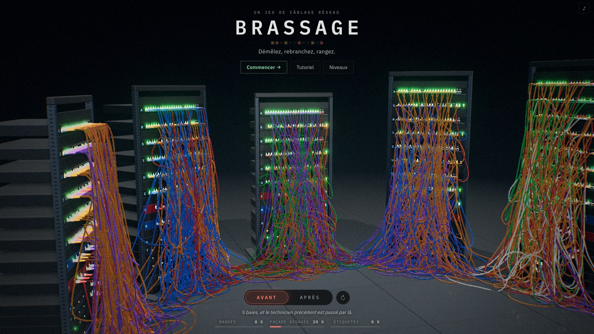

# Brassage

Un jeu de *cable management* en 3D, dans le navigateur. On se retrouve devant
une baie réseau en désordre : des câbles emmêlés, certains mal branchés,
d'autres qui pendent jusqu'au sol. Il faut rebrancher chaque liaison selon le
plan de brassage, puis ranger proprement les câbles, comme un technicien sur
un vrai chantier.

Les câbles sont simulés physiquement : ils ont un poids, frottent les uns sur
les autres et s'empilent. Aucun câble ne traverse un équipement ni un élément
de rangement. La difficulté tient à l'organisation de la baie : par quels
guides faire passer chaque câble, avec quelle longueur, dans quel ordre.

**[Jouer en ligne](https://drschizzo.github.io/cablemanagement/)**, sans rien
installer (un navigateur récent avec WebGPU, ou à défaut WebGL 2, suffit).



## Lancer le jeu en local

Il faut Node.js 20 ou plus récent. Le moteur de câbles et le rendu des tubes viennent d'un sous-module git
([cable-kit](https://github.com/drschizzo/cable-kit)) : clonez avec `--recurse-submodules`, ou récupérez-le
après coup.

```bash
git submodule update --init
```

```bash
npm install
```

```bash
npm run dev
```

Le jeu s'ouvre sur http://localhost:5173, sur l'**écran titre** : une salle de
baies en désordre. Au premier lancement, un seul bouton, **Commencer**, et en discret le tutoriel et
les paramètres. L'interrupteur **Avant / Après** montre la même salle une fois rangée.

**Commencer** ouvre le **tutoriel**, qui présente pas à pas ce que demande le premier niveau
(saisir, brancher, ranger au Chemin, valider la baie), puis, au choix, les **gestes avancés** (coude
pincé, seconde main, goulotte, velcro). La goulotte s'explique aussi dans le brief du premier niveau
qui la donne. Par la suite, le même bouton reprend où en est l'histoire : la **formation** (cinq
niveaux), puis la **carrière**. L'écran titre montre aussi les **modes de jeu** :

| Groupe | Modes | S'ouvre |
|---|---|---|
| Histoire | la formation, puis la carrière | la formation tout de suite, la carrière à sa fin |
| Partie libre | la baie libre : une des grandes baies, ou une baie réglée par le joueur | tout de suite |

La carrière est le seul mode fermé au départ ; elle s'ouvre à la fin de la formation.

Dans un niveau, **☰ Menu** (ou **Échap**) met le jeu en pause : consignes,
recommencer, choisir un autre niveau, paramètres, retour à l'accueil. Quitter
une baie déjà entamée demande confirmation.

Les **Paramètres** règlent la langue (français ou anglais), la qualité de l'image, le son et la musique. En **Auto**, la
qualité s'abaisse d'elle-même quand la carte graphique ne suit plus (le jeu le
signale) ; on peut aussi la fixer (Maximale, Élevée, Moyenne, Basse) ou régler
chaque effet : définition, ombres, occlusion ambiante, reflets au sol. Le choix
est gardé dans le navigateur ; `?quality=N` dans l'URL (0 à 6) fixe un niveau
le temps d'une visite.

## Le jeu

### Objectif

Chaque niveau fournit un **plan de brassage** : la liste des liaisons à établir
(tel port du panneau vers tel port du switch). Pour **valider** la baie, il faut :

1. brancher chaque liaison sur les bons ports, avec le bon type de câble
   (fibre ou cuivre) ;
2. ranger les câbles : aucune portion de plus de 20 cm ne doit pendre hors d'un
   guide-câbles ou d'une goulotte ;
3. dégager la façade : aucun câble ne doit passer devant le port d'un autre ;
4. ne rien tendre ni plier : un câble bien plus court que son chemin dans les supports
   est tendu, une fibre en angle vif est pliée.

Le bouton **Valider** reste grisé tant que ce n'est pas fait. Le velcro est facultatif : il serre des
câbles en faisceau, sans compter pour valider.

Un câble branché comme prévu reçoit tout seul l'étiquette de son service.

Le jeu ajoute ses règles une à une : le brief d'un niveau explique celles qu'on y rencontre pour la
première fois (la baie en production au niveau 3, la fibre qui se plie au niveau 5, le courant au
ticket 3 de la carrière, les incidents au ticket 4…), et ne répète pas les autres.

Certaines baies ajoutent des **exigences du client**, seulement là où elles ont un sens :

| Exigence | Dans quelles baies |
|---|---|
| rester dans le budget d'interruption | les baies en production |
| le courant dans d'autres goulottes que les données (cuivre et fibre) | les baies qui ont des câbles d'alimentation |

Une exigence ne bloque pas la validation : le dossier du niveau garde combien d'exigences ont été
remplies (« 1/2 exigences du client »), et une baie qui n'en a pas est simplement validée.

Le joueur suit trois choses : **branché**, **rangé**, **en production**. Un câble est rangé quand
il ne pend nulle part hors des supports, ne passe devant aucun autre port, et n'est ni tendu ni plié
(règles 2 à 4 ci-dessus).

Le jeu dit toujours *câble* pour l'objet qu'on tient et *liaison* pour une ligne du plan ; un câble est
*rangé*, une liaison *branchée*. Une règle s'écrit en une phrase, sans exception entre parenthèses.

Une baie validée a droit à son tour d'honneur : la caméra fait le tour de la baie
pendant que les câbles s'allument de haut en bas, puis l'écran de résultat s'ouvre.

L'écran de fin propose de **revoir le chantier en accéléré** : l'état de la baie, relevé quatre fois
par seconde de jeu, rejoué en cinq secondes par la vue 3D elle-même, à la cadence de l'écran ; de
l'**enregistrer en vidéo**, et de télécharger l'**image avant / après** de la baie, avec
les exigences remplies.

Valider un niveau de la formation ouvre le suivant ; valider un ticket de la carrière ouvre le ticket
suivant. Sous le plan, deux listes montrent dès le départ ce qui reste à faire et où en est la baie :
**Pour valider** (« Ranger les 6 câbles 4/6 : 1 pend hors des supports, 1 passe devant un port ») et,
s'il y en a, **Exigences du client** (« Rester dans le budget d'interruption 38/250 »). Un câble qui devient rangé s'allume en vert avec
une note. Un câble tendu dit combien de centimètres il lui
manque.

Chaque niveau de la formation et chaque grande baie cache une **trouvaille** laissée par un technicien précédent (un post-it,
une clé USB, un canard en plastique…) : sur le plancher de la baie sous les câbles, sur son toit ou dans
le bac. Un clic la ramasse et raconte son histoire. Le **carnet du technicien** (écran titre, dès la
première trouvaille ou le niveau 3) les rassemble, et dit où chercher celles qui manquent (deux se
cachent ailleurs). En prime, il offre des teintes qui s'ouvrent avec les coches gagnées (une par baie
validée, une par exigence du client remplie) : la couleur des velcros, la lumière autour de la baie. Rien de ce qui porte un sens (câbles, étiquettes,
voyants) ne change.

### Préparation

Dans un niveau qui fournit des supports, le chantier commence par une
**préparation** : la baie est figée et le chrono arrêté. On lit le plan, on pose
guide-câbles et goulottes là où les câbles passeront, puis on lance le
chantier.

### Production et services

À partir du niveau 3, la baie est en production : les liaisons qui fonctionnent au départ (marquées
⚡ dans le plan) portent du trafic. Chaque seconde où l'une d'elles est coupée
coûte le **poids de son service** sur un **budget d'interruption**, affiché en
haut de l'écran :

| Service | Ce qu'il porte | Poids |
|---|---|---|
| Admin | pare-feu, routeur, supervision | ×4 |
| Voix | téléphones IP | ×3 |
| Stockage | serveurs et disques | ×3 |
| Vidéo | caméras | ×2 |
| Données | postes de travail | ×1 |
| Invités | Wi-Fi des visiteurs | ×0,25 |

On peut toujours débrancher, pour démêler par exemple ; au-delà du budget, un
incident est déclaré et l'exigence du budget n'est plus remplie. Une **dérivation** (clic sur
le ⚡ d'une ligne du plan) porte le trafic d'une liaison pendant qu'on la
recâble, puis revient au stock quand la liaison est rétablie. Les voyants d'une
liaison coupée clignotent en rouge, ceux d'une liaison dérivée en ambre.

### Incidents

Dans la carrière (tickets 4, 9 et 12) et dans une baie libre en production à partir de 12 câbles, le chantier ne se
déroule pas tout seul : **un collègue débranche une liaison par erreur**, puis **un utilisateur
appelle** pour une liaison coupée. Un compte à rebours s'affiche en haut de l'écran et sa ligne
s'allume dans le plan : rétablie à temps, tout va bien ; trop tard, l'appel coûte 40 points sur le
budget d'interruption.

### Pannes

Certaines baies (les tickets 6 et 9 de la carrière, une baie libre en production à partir de 16 câbles) cachent un **vieux câble coupé à l'intérieur** : branché comme prévu, il ne porte rien et
ses voyants clignotent en rouge. Le **Testeur** (touche 4) dit d'un clic si un câble laisse passer le
signal ; un câble coupé se jette au bac et se remplace par un neuf du Stock.

### Courant

Certaines baies (le ticket 3 de la carrière et la suite, les baies libres qui ont un bandeau électrique) alimentent
leurs serveurs : des **câbles d'alimentation** noirs, raides, à fiche C13, vont des prises du
**bandeau électrique** aux deux alimentations de chaque serveur. Couper l'une, c'est couper le service
du serveur. Le client demande que le courant ne partage aucune goulotte avec les données : on le
descend d'un côté de la baie, les données de l'autre.

### Câbles neufs

Le **Stock** fournit des câbles neufs, comptés par longueur ; ils arrivent
enroulés dans le bac au pied de la baie. Remplacer un câble branché, c'est le
débrancher, donc couper sa liaison le temps de changer : savoir qui reçoit quel
câble, et dans quel ordre, fait partie du plan.

### Formation

La **formation** apprend le métier en cinq niveaux, une règle de plus à chacun :

| # | Niveau | Câbles · particularité |
|---|---|---|
| 1 | Premier brassage | 4 |
| 2 | Le mou | 6 |
| 3 | Erreurs de brassage | 8 · baie en production |
| 4 | Les services | 10 · trois services |
| 5 | Fibre et cuivre | 12 · fibre pliable |

### Carrière

La **carrière**, qui suit la formation, est le cœur du jeu. Elle suit une petite radio locale, Radio Pinède (98.4 FM), sur douze tickets (une liaison coupée, c'est un
blanc à l'antenne). C'est **toujours la
même baie** : chaque ticket repart de la baie telle que vous l'avez laissée au précédent (câbles,
supports, velcros), installe du matériel dans les unités gardées libres (un serveur et son bandeau
électrique, un deuxième panneau et son switch), crée des liaisons, en retire d'autres dont il faut jeter les câbles. Ce qui a
été bien rangé le reste ; ce qui a été bâclé vous attend. Le dernier ticket est le direct des 40 ans de la radio.

Chaque ticket apporte au plus une chose nouvelle, et la carrière reprend ainsi tout ce que la
formation n'a pas montré :

| # | Ticket | Ce qu'il apporte |
|---|---|---|
| 1 | Premier jour à Radio Pinède | la baie en désordre à remettre en ordre |
| 2 | La rédaction s'installe | six liaisons de plus |
| 3 | Quarante ans de cassettes | un serveur et son courant |
| 4 | Le collègue du son | les incidents : un collègue débranche, le standard appelle |
| 5 | L'émission de nuit déménage | des liaisons retirées, leurs câbles au bac |
| 6 | Un câble fatigué | une panne, le Testeur |
| 7 | Le festival de la pinède | un deuxième panneau et son switch |
| 8 | Le studio de la matinale | trois liaisons, des velcros à disposition |
| 9 | La nuit de l'orage | pannes et incidents ensemble |
| 10 | Radio Pinède sur internet | le serveur de diffusion |
| 11 | La soirée électorale | un budget d'interruption serré |
| 12 | Le direct des 40 ans | deux liaisons pendant le direct, avec des incidents |

### Baie libre

La **baie libre** propose les trois **grandes baies**, des salles chargées où toutes les règles se
croisent, ou une baie que le joueur règle lui-même :

| Grande baie | Câbles · particularité |
|---|---|
| Salle serveurs | 20 · goulottes comptées |
| Migration | 24 · budget d'interruption serré |
| Le plat de spaghettis | 28 · câbles sans marque, à tracer |

Une baie réglée se compose avec une palette d'équipements (panneaux, switchs, pare-feu, routeur,
serveurs, onduleur, bandeau électrique, unités vides), du haut vers le bas ; le nombre de câbles (de 1
à 48 : il ajoute au besoin un panneau et un switch), le nombre de services, le désordre de départ.
**En production**, elle a un budget d'interruption, des incidents à partir de 12 câbles et une panne
à partir de 16 ; **hors production**, ni budget ni incident, du matériel en abondance et une musique
d'ambiance générée à la volée (qu'on peut couper dans les Paramètres). Chaque partie tire un nouveau
désordre. Le **lien** de la baie (`?rack=CODE`) l'ouvre telle quelle chez quelqu'un d'autre.

## Commandes

| Action | Geste |
|---|---|
| Saisir et tirer un câble | clic gauche + glisser |
| Pousser vers le fond / ramener vers soi | **Maj** + souris vers le haut / le bas pendant qu'on tire (ou la molette) |
| Pincer un coude, qui garde sa forme | maintenir **Espace** (ou le clic droit) pendant qu'on tient le câble : plus longtemps, plus ferme |
| Défaire un coude pincé | survoler le câble (ses coudes apparaissent en cercles), puis **Espace** sur le coude |
| Passer le câble à l'autre main, qui le tient sur place | **E** pendant qu'on tire ; **E** main libre pour qu'elle le lâche |
| Débrancher | saisir un connecteur et tirer de quelques centimètres |
| Brancher | relâcher un connecteur devant un port libre (surligné en jaune) |
| Accrocher un connecteur en l'air | le relâcher devant la baie, loin d'un port : il y reste (lueur ambrée) ; Alt en lâchant : il pend |
| Sortir un bout libre du tas | cliquer la ligne du plan : il s'accroche sous son port |
| Tracer un câble | survoler le câble, **T** : il clignote et ses deux ports s'entourent |
| Jeter un câble au bac | survoler le câble, **Suppr** |
| Dériver une liaison en production | cliquer son ⚡ dans le plan |
| Attraper le câble du dessous | **Tab** |
| Annuler le dernier geste | **Ctrl+Z** (⌘Z) |
| Tourner la vue | clic droit + glisser, sans tenir de câble |
| Déplacer la vue | glisser dans le vide, ou flèches du clavier |
| Zoomer / revenir de face | molette / **R** |
| Poser l'outil, puis ouvrir le menu (pause) | **Échap** |
| Couper / remettre le son | **M** |
| Statistiques de la physique | **F3** |

Sous la baie, une bande rappelle les **touches du moment** : celles de l'outil en main et du
câble survolé (T pour tracer, Suppr pour le bac, Tab pour le suivant…), et pendant un geste, ce
qu'on peut faire en le tenant. L'aide complète d'un outil reste sur son bouton.

### Les outils

| Touche | Outil | Usage |
|---|---|---|
| 1 | Main | saisir, tirer, brancher, débrancher, pincer |
| C | Chemin | tracer le chemin d'un câble à travers les guides ; il y est posé, et branché au port où finit le trait |
| 2 | Supports | dans une unité vide, un guide-câbles ; dans un couloir latéral, une goulotte ; sur un support posé, le retirer |
| 3 | Velcro | facultatif : tracer un trait en travers des câbles à serrer ; le velcro serre ceux que le trait croise, s'ils sont côte à côte ; un clic sur un velcro l'enlève |
| 4 | Testeur | dit si un câble porte le signal (seulement là où des câbles sont coupés) |
| 0 | Stock | prend un câble neuf (type, couleur, longueur), livré dans le bac |

### Ranger un câble

L'outil **Chemin** sert à ranger. On appuie sur un câble et on trace un trait
par-dessus les guides qu'il doit traverser, dans l'ordre ; chaque guide retenu
s'encadre de vert. Si le trait se termine sur un port libre, le bout libre du
câble s'y branche. Au relâcher, le câble est posé le long du chemin : il passe
où passe le trait entre les guides, et entre dans chacun du côté d'où vient le
trait (par une extrémité du guide-câbles plutôt qu'entre ses doigts, par exemple).

- Il entre dans chaque élément par son ouverture : par l'avant du guide-câbles,
  au-dessus des pointes des doigts ; par la fente avant de la goulotte.
- Un câble trop court pour tout le trait en coupe les détours hors des guides ;
  il n'est refusé, avec la longueur qui manque, que s'il ne peut pas passer par
  les guides.
- La longueur en trop est rangée en boucle dans la goulotte, sinon repliée dans
  le guide-câbles ; ce qui ne tient pas pend. Un câble plus court se prend au
  Stock.

Tout peut aussi se faire à la main, câble par câble. Après un geste, le câble
se colore un moment par portion : vert là où un support le tient, orange là où
il pend de plus de 20 cm, rouge là où il traîne au sol.

## Développement

Le projet est écrit en TypeScript, avec [three.js](https://threejs.org) pour le
rendu et Vite pour le serveur et la construction. Il n'y a pas de serveur : tout
tourne dans le navigateur.

| Dossier | Contenu |
|---|---|
| `src/app/` | quelle scène est à l'écran (un niveau ou l'écran titre), et comment passer de l'une à l'autre |
| `src/game/` | les règles et la physique de la baie, sans affichage : elles tournent aussi sous Node et dans un Worker |
| `src/play/` | une partie en cours : la boucle, les outils du joueur, les repères visuels |
| `src/showcase/` | l'écran titre, l'allée de baies avant / après |
| `src/render/` | le dessin three.js : baie, câbles, connecteurs, éclairage |
| `src/progression/` | ce que le joueur garde d'une visite à l'autre : progression, carrière, carnet, réglages |
| `src/ui/` | l'interface HTML : plan de brassage, outils, tutoriel, écran de résultat, écran titre |
| `src/lib/` | des outils sans rapport avec le jeu (géométrie, tirages au sort, langue parlée), que tout le monde peut importer |
| `tests/` | tests unitaires (Vitest), rangés comme `src/` |
| `tools/` | bancs d'essai du moteur, des gestes et des niveaux, sans navigateur ([index](tools/README.md)) |
| `vendor/cable-kit/` | sous-module git, le dépôt [cable-kit](https://github.com/drschizzo/cable-kit) : le moteur de câbles et son Web Worker (`@drschizzo/avbd-cables`), les tubes construits par le GPU (`@drschizzo/three-cable-tubes`) |

Chaque dossier ne dépend que de ceux qui sont en dessous de lui (`lib` puis `game` en bas,
`app` en haut), et ESLint le vérifie à chaque `npm run lint`.

### Lire le code

Quatre documents, du plus général au plus détaillé :

- [`docs/architecture.md`](docs/architecture.md) : l'organisation du code, le
  sens des dépendances entre les dossiers, et où intervenir pour ajouter un
  niveau, un outil ou un critère de score ;
- [`docs/conventions.md`](docs/conventions.md) : les règles que le code suit
  (découpage, nommage, commentaires, tests, commits), avec un exemple tiré du
  projet pour chacune ;
- [`docs/mise-a-jour-three.md`](docs/mise-a-jour-three.md) : ce que le jeu prend
  à three.js au-delà de son API stable, et comment monter de version ;
- [`docs/anatomie-d-une-frame.md`](docs/anatomie-d-une-frame.md) : une frame
  suivie de bout en bout, avec schémas et captures (la boucle de jeu, le
  moteur physique des câbles, la préparation de la scène, le rendu).

Pour une première lecture, suivre le chemin d'un clic :

1. `src/main.ts` crée l'`App` (`src/app/app.ts`), qui lance un niveau en créant
   un `Controller` ;
2. `src/play/controller.ts` fait tourner la boucle (`tick`) et confie la souris
   à `src/play/inputRouter.ts` ;
3. le clic arrive à un outil, par exemple `src/play/tools/handTool.ts`, qui
   saisit le câble et le branche avec `World.plug` (`src/game/world.ts`) ;
4. `src/game/evaluation.ts` note la baie, et le contrôleur prévient
   l'interface par un événement : `src/ui/hud.ts` le passe au panneau du plan
   (`src/ui/schedulePanel.ts`).

### Commandes utiles

| Commande | Rôle |
|---|---|
| `npm run dev` | serveur de développement |
| `npm run build` | version de production dans `dist/` (publiée sur GitHub Pages à chaque push sur `main`) |
| `npm run check` | lint (dont le sens des dépendances), types et tests, à lancer avant de pousser |
| `npm run solvable` | vérifie que chaque niveau peut être validé avec toutes ses exigences, avec son seul inventaire ; puis, depuis l'emmêlement de départ, combien de liaisons en production il faudra débrancher, ce que cela coûte face au budget d'interruption, et les câbles neufs qu'il faut |
| `npm run bench` | performance et stabilité du moteur physique |
| `npm run precision` | gestes délicats : entrer dans une goulotte, coucher un câble dans un guide-câbles… |
| `npm run levels` | coût et mise au repos de chaque niveau |
| `npm run free` | une partie libre de 48 câbles : mise au repos, puis un câble tiré à travers les autres |
| `npm run pinch` | un coude pincé garde-t-il sa forme une fois lâché |
| `npm run route` | des câbles posés le long d'un chemin tracé : branchés, dans leurs guides, au repos, sans traverser la baie, et ce qu'ils déplacent des autres câbles |
| `npm run fold` | un câble couché dans un guide-câbles : le guide prend-il une boucle lointaine du même câble |
| `npm run showcase` | la démonstration avant / après sur quelques baies tirées au sort |

Ajouter `?sync` à l'URL fait tourner la physique sur le fil principal plutôt
que dans le Worker, ce qui rend les tests automatisés reproductibles.

### Le moteur physique

`vendor/cable-kit/packages/avbd-cables/src/cableSim.ts` s'inspire d'*Augmented Vertex Block Descent* (Giles,
Diaz, Yuksel, SIGGRAPH 2025). Chaque câble est une chaîne de nœuds ; le
solveur traite l'inextensibilité et les contacts (câble contre câble, câble
contre baie) comme des contraintes dures, et la flexion, le frottement, la
main, le velcro et les coudes pincés comme des énergies. Un coude pincé garde
sa forme par *shape matching* : ses nœuds sont tirés vers cette forme,
tournée et déplacée pour leur aller au mieux. Les câbles immobiles se mettent en
veille pour que les grosses baies restent fluides. Le moteur tourne dans un
Web Worker (`src/game/physics/sim.worker.ts`, piloté par `threadedSim.ts`, tous deux bâtis sur `threaded.ts` du moteur) : l'affichage
n'attend jamais la physique.

## Licence

[MIT](LICENSE).
