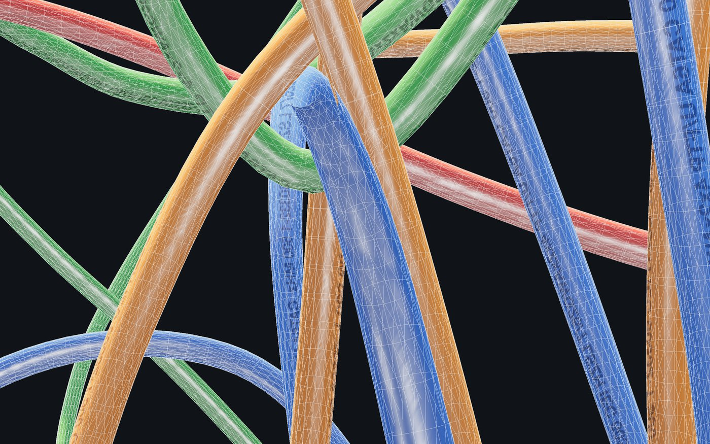
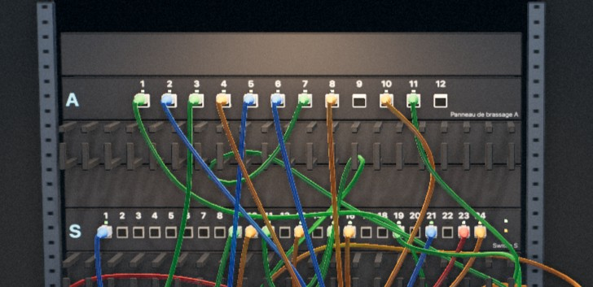
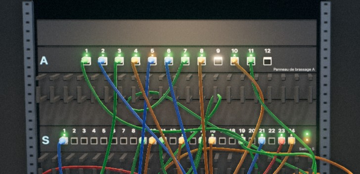

# Anatomie d'une frame : moteur physique et pipeline de rendu

## Introduction

Pour afficher une image, Brassage lit la souris, fait avancer la physique des câbles dans un Web Worker, envoie à la carte graphique les nœuds des câbles qui ont bougé, puis lui demande de dessiner la scène en plusieurs passes. Ce document décrit chacune de ces étapes, dans l'ordre où elles s'exécutent, avec les fichiers du dépôt qui les réalisent.

Brassage est un jeu de rangement de câbles dans une baie réseau. Le rendu utilise [three.js](https://threejs.org/), une bibliothèque qui simplifie l'usage de WebGL. La physique des câbles est écrite pour le projet, dans `src/physics/cableSim.ts`, sans bibliothèque externe.


Image finale du niveau 4 (« Étiquetage » : 10 câbles à brancher et 3 liaisons déjà en service, soit 13 câbles), telle que la produit la boucle décrite ici. Toutes les captures de ce document viennent de ce niveau, rendu dans une fenêtre de 1280 × 800 pixels avec une densité de 2 pixels physiques par pixel CSS.

### Ce qu'est une frame

Un jeu affiche une suite d'images fixes, appelées frames. Le navigateur en demande une à chaque rafraîchissement de l'écran, en général 60 fois par seconde. Le jeu dispose donc d'environ 16,7 ms pour tout faire : lire les entrées, faire avancer la simulation, préparer les données pour la carte graphique (le GPU) et lancer le dessin. Si ce travail dépasse le budget, l'écran garde l'image précédente une période de plus et le mouvement saccade.

Dans Brassage, une frame se découpe en quatre étapes :

1. **Entrées** : la position de la souris déplace la « main » qui tient un câble.
2. **Physique** : le moteur calcule les nouvelles positions des câbles. Ce calcul tourne sur un autre fil d'exécution (un Web Worker), en parallèle du reste.
3. **Préparation de la scène** : le processeur (le CPU) envoie au GPU les positions des nœuds qui ont bougé ; le GPU en tire lui-même les triangles des câbles.
4. **Rendu** : le GPU dessine la scène, puis applique une série de passes de post-traitement avant l'affichage.

Le schéma ci-dessous montre qui fait quoi, et sur quel fil d'exécution.


Le fil principal envoie une demande de pas au Worker et continue sans attendre. Il dessine les dernières positions reçues, puis le GPU exécute les passes de rendu dans l'ordre, de gauche à droite.

### Comment lire ce document

Les sections suivent l'ordre d'exécution d'une frame et peuvent se lire séparément. Chacune se termine par une liste « À retenir ». La section *Moteur physique* est la plus longue ; sa partie « Détail mathématique » est facultative. Aucun calcul n'est nécessaire pour suivre le reste : les rares formules sont des notations courtes pour des opérations décrites en mots juste à côté.

## La boucle principale

La boucle est une fonction que le navigateur rappelle à chaque rafraîchissement de l'écran via `requestAnimationFrame`. Elle mesure le temps écoulé depuis l'appel précédent, fait avancer la physique par pas de durée fixe, puis dessine. Elle se trouve dans `src/game/controller.ts`, méthodes `frame` et `tick`.

### requestAnimationFrame

Un développeur web connaît `setTimeout` et `setInterval`. Pour l'animation, le navigateur fournit `requestAnimationFrame(callback)` : il appelle `callback` juste avant de peindre la prochaine image, au rythme de l'écran (60 Hz, 120 Hz sur certains écrans), et suspend les appels quand l'onglet est caché. La fonction se réinscrit elle-même à chaque appel :

```ts
private frame = (): void => {
  if (this.disposed) return;
  requestAnimationFrame(this.frame);
  const now = performance.now();
  const dt = Math.min(0.1, (now - this.last) / 1000);
  this.last = now;
  this.tick(dt);
};
```

`dt` est le temps réel écoulé depuis la frame précédente, en secondes. Il est plafonné à 0,1 s : après une pause longue (onglet en arrière-plan, débogueur), le jeu ne tente pas de rattraper plusieurs secondes de simulation d'un coup.

### Un pas de temps fixe pour la physique

L'affichage suit le rythme de l'écran, qui varie d'une machine à l'autre. La physique, elle, avance toujours par pas de 1/60 s (`P.dt` dans `cableSim.ts`). Un solveur physique donne des résultats différents selon la taille du pas : avec un pas variable, un câble ne se poserait pas de la même façon sur deux ordinateurs, et un pas trop grand rendrait la simulation instable.

La boucle utilise donc un accumulateur. Le temps réel s'y ajoute ; tant qu'il contient au moins un pas, on retire un pas et on compte une étape de physique :

```ts
const h = this.world.sim.P.dt;        // 1/60 s
this.acc += dt;
let steps = 0;
while (this.acc >= h && steps < 2) {
  this.stepHand();                    // la main avance vers la souris
  this.acc -= h;
  steps++;
}
if (this.acc > h) { this.dropped += Math.floor(this.acc / h); this.acc = 0; }
if (steps) this.world.sim.advance(steps);
```

Sur un écran à 60 Hz, la boucle fait en général un pas par frame. Sur un écran à 120 Hz, une frame sur deux n'en fait aucun. Si une frame a pris du retard, elle en fait deux. Au-delà de deux, le temps restant est abandonné et compté dans `dropped`. Sans cette limite, une machine trop lente pour la physique accumulerait du retard : chaque frame devrait calculer plus de pas que la précédente, et donc prendre encore plus de temps. Avec la limite, le jeu passe au ralenti au lieu de se bloquer.


Les losanges marquent les pas de physique, toujours espacés de 16,7 ms. À 120 Hz, une frame sur deux ne lance aucun pas. Quand une frame dure deux fois plus longtemps que prévu, la suivante lance deux pas pour rattraper le temps.

### L'ordre des opérations dans `tick`

Une fois la physique demandée, `tick(dt)` enchaîne les opérations suivantes :

1. Les animations d'interface : clignotement d'un câble tracé (outil Tracer), pulsation du repère qui montre où poser un élément.
2. L'accumulateur et `sim.advance(steps)`, décrits plus haut. `advance` envoie la demande au Worker et rend la main immédiatement.
3. `cableView.update()` : les câbles qui ont bougé sont reconstruits en triangles (section *Préparation de la scène*).
4. `rackView.syncItems(...)` : si le joueur a posé ou retiré un guide-câbles, la baie est mise à jour.
5. Toutes les 0,4 s seulement, `reevaluate()` : le score, les voyants des ports et le plan de brassage du HUD sont recalculés. Ce calcul n'a pas besoin d'être fait 60 fois par seconde.
6. `updateGlows()` et `updateHoldView()` : surbrillance des câbles rangés et du câble tenu.
7. `stage.render()` : le dessin complet de l'image (sections *Rendu* et *Post-traitement*).

L'interface HTML (panneaux, chronomètre) n'est pas mise à jour dans cette boucle. `main.ts` l'actualise par un `setInterval` toutes les 250 ms, ce qui évite de modifier le DOM 60 fois par seconde.

### À retenir

- Le navigateur appelle la boucle à chaque rafraîchissement de l'écran, via `requestAnimationFrame`.
- La physique avance par pas fixes de 1/60 s, au plus deux par frame, quel que soit le rythme de l'écran.
- Les travaux qui n'ont pas besoin d'être faits à chaque frame (score, interface HTML) sont espacés.

## Entrées et logique de jeu

Les événements de la souris ne déplacent rien directement : ils enregistrent la position du pointeur et l'état du geste, et c'est la boucle qui s'en sert au moment de chaque pas de physique. Ce découplage garantit que la main avance au même rythme que la physique, quelle que soit la fréquence des événements.

### Les événements

`Controller.bind()` installe des écouteurs classiques sur le `<canvas>` : `pointermove`, `pointerdown`, `pointerup` (sur `window`, pour ne pas perdre le relâchement hors du canvas), plus le clavier. Ils mettent à jour `mousePx` (position en pixels) et `mouse` (position normalisée entre −1 et 1, le format qu'attend three.js).

La caméra est pilotée par `OrbitControls`, un module de three.js : bouton droit pour tourner autour de la baie, bouton du milieu ou flèches pour déplacer la vue, molette pour zoomer. Le mouvement est amorti (`dampingFactor` 0,12) : la caméra continue de glisser un peu après le geste. Cet amortissement est calculé dans `controls.update()`, appelé au début de chaque rendu.

### Savoir quel câble est sous la souris

Dans une page web, le navigateur dit sur quel élément se trouve la souris. Dans une scène 3D dessinée sur un canvas, il faut le calculer : c'est le *picking*.

La méthode habituelle consiste à lancer un rayon depuis la caméra à travers le pixel visé et à tester son intersection avec les triangles. Brassage fait autrement, dans `pickAll()` : il projette à l'écran les 667 nœuds de la physique, puis cherche en 2D le segment le plus proche du pointeur.

1. Chaque nœud est converti en position à l'écran, en pixels, par la même transformation que celle que le GPU applique pour dessiner (elle est décrite dans *La caméra et les matrices*). Le calcul donne aussi la distance du nœud à la caméra.
2. Deux nœuds consécutifs forment un segment à l'écran. Pour chacun, on mesure la distance entre le pointeur et le segment. Le segment est retenu si cette distance est inférieure à une tolérance : l'épaisseur du câble à l'écran, plus quelques pixels.
3. Les câbles retenus sont classés du plus proche au plus lointain de la caméra. Un connecteur est avantagé de 4 à 12 cm, pour rester attrapable au milieu d'un tas. La touche Tab passe au câble suivant de la liste.


Cette méthode coûte quelques centaines de multiplications, contre plusieurs dizaines de milliers de triangles à tester par rayon. Elle s'appuie aussi sur les positions de la physique, qui sont la vérité du jeu, plutôt que sur le maillage dessiné.

### La main qui tient un câble

Au clic, `startDrag` appelle `sim.grab(nœud)` : le nœud saisi devient la « main ». Ensuite, à chaque pas de physique, `stepHand()` :

1. lance un rayon depuis la caméra à travers le pointeur (`THREE.Raycaster`) et calcule son intersection avec un plan vertical, à la profondeur où le câble a été saisi. Avec la touche Maj, la souris déplace la main en profondeur au lieu de la hauteur ;
2. déplace la cible de la main vers ce point, d'au plus 3,5 cm par pas (`MAX_TARGET_STEP`) ;
3. limite la cible pour qu'elle ne rentre pas dans les équipements, les parois ou le sol ;
4. écrit la cible dans `sim.grabTarget`, que le solveur lit à chaque pas ;
5. si le câble tenu par son connecteur a été tiré de plus de 4 cm (`UNPLUG_PULL`), le débranche.

Le solveur ne téléporte pas le nœud sur la cible : il le tire vers elle avec un ressort, d'au plus 6 cm (`grabLead`). Un câble coincé ne s'étire donc pas à l'infini, et il ne rebondit pas quand on le lâche.

Ce ressort en laisse est la **cible** du moteur (`setTarget`) : un point, une raideur, une longueur de laisse, et un drapeau qui rend le nœud lourd dans les passes de longueur, pour que le câble suive la main plutôt que l'inverse. Chaque nœud a au plus une cible. La main, l'autre main, le connecteur poussé dans son port et le chemin tracé posent la leur au début de chaque pas (`aim`) ; sur un même nœud, la main l'emporte sur l'autre main, qui l'emporte sur le connecteur, qui l'emporte sur le chemin.

Une cible ne tire jamais un nœud plus loin que le câble ne le permet. Au début de chaque pas, `reach` la ramène à moins d'une longueur de câble des nœuds épinglés du même câble, de part et d'autre : sur la sphère centrée sur l'épingle, ou là où les sphères des deux épingles se rejoignent. Sans cela, une main tirée au-delà tendait le câble de toute sa force contre l'épingle. Les passes de longueur, qui ne déplacent ni l'épingle ni (presque) la main, ne pouvaient pas reprendre l'allongement des nœuds légers entre les deux, et le câble fouettait comme un élastique.

### Le chemin tracé

Avec l'outil Chemin, le joueur part d'un câble et trace un trait à l'écran. Chaque guide que le trait traverse (un rayon par le pointeur, contre la zone du guide) rejoint le chemin, dans l'ordre du passage ; un guide traversé de nouveau prend sa place au dernier passage. Si le trait finit sur un port libre, le bout libre du câble y sera branché. Au relâcher, `planRoute` (`src/game/route.ts`) calcule le chemin :

1. il part du bout qui reste en place (le bout branché, le plus proche du premier guide si les deux le sont) ;
2. il passe par les points du trait tracés hors des guides (simplifiés, ramenés dans la baie ; ceux qui longent de près un guide comptent comme dedans). Rien n'y retient le câble : un cordon trop court pour tout le trait en coupe les détours, celui qui fait gagner le plus d'abord, comme un câble qu'on tend ;
3. il traverse chaque guide dans son couloir : un couloir par câble déjà posé. Il y entre du côté d'où vient le trait : entre les doigts du guide-câbles depuis un port au-dessus ou au-dessous, par son extrémité depuis un couloir latéral ; par une fente de la paroi intérieure pour entrer dans une goulotte ;
4. il finit au port d'arrivée. Un cordon trop court pour les guides et leurs côtés d'entrée est refusé, en disant combien il manque. La longueur en trop est rangée comme le ferait un technicien : en boucle pendante dans une goulotte, sinon repliée dans un guide-câbles ; ce qui reste fait un ventre.

Le câble n'est pas téléporté. `RouteRun` mène chaque nœud par un ressort en laisse (`sim.setGoals`), comme la main, en trois temps partagés par tous les nœuds : sortir vers l'avant de la baie, traverser devant elle jusqu'à la forme du chemin, puis entrer par l'ouverture de chaque guide. Le décalage vers l'ouverture est étalé sur les nœuds voisins, pour que le câble garde une forme de câble. Les contacts avec la baie restent des contraintes dures : un câble qui rencontre un élément s'y arrête, il ne le traverse pas. Les autres câbles, eux, il les traverse : mené par des ressorts plus forts que la main, il les emporterait avec lui. Une fois relâché, chaque nœud redevient solide dès qu'il ne chevauche plus aucun câble ; ceux qui chevauchent encore un câble au bout d'un moment (`ghostFrames`) le repoussent. À la fin, le câble est tenu un instant puis relâché, et le bout libre se branche s'il est arrivé devant son port.

### Les autres outils et les règles

Les autres outils modifient le monde physique par des appels ponctuels : brancher un connecteur l'épingle sur le port (`sim.pin`), un velcro relie des nœuds de plusieurs câbles (`sim.addBundle`), un guide-câbles ajoute des formes de collision (`sim.setStatics`). Chaque modification est appliquée localement puis transmise au Worker, dans l'ordre (section *Moteur physique*).

Les règles du jeu vivent dans `src/game/world.ts`, sans three.js ni DOM. `World.evaluate()` vérifie les liaisons du plan, les portions de câble qui pendent hors d'un support, la façade dégagée et les étiquettes. Elle tourne toutes les 0,4 s, comme indiqué plus haut. Avant chaque geste, `remember()` garde une copie de l'état pour l'annulation (Ctrl+Z, 30 états au plus).

### À retenir

- Les événements enregistrent l'état de la souris ; la boucle s'en sert à chaque pas de physique.
- Le picking projette les nœuds de la physique à l'écran et cherche le segment le plus proche du pointeur.
- La main tire le câble avec un ressort ; les outils modifient le monde physique par des appels transmis au Worker.

## Moteur physique

Le moteur représente chaque câble par une chaîne de points pesants et calcule, à chaque pas de 1/60 s, la position de ces points qui respecte au mieux la gravité, la longueur des câbles, leur raideur et les contacts. Il utilise la méthode AVBD (*Augmented Vertex Block Descent*, Giles, Diaz et Yuksel, SIGGRAPH 2025) et tourne dans un Web Worker. Le solveur est dans `src/physics/cableSim.ts`, qui ne connaît pas la baie. `src/game/rackSim.ts` le mène comme le jeu en a besoin (les mains, le chemin, les connecteurs, le creux des guides), et `src/game/threadedSim.ts` et `sim.worker.ts` le déplacent hors du fil principal.

Cette section est la plus longue du document. Pour une première lecture, le modèle, « La méthode, en trois idées », l'exemple chiffré et le schéma du déroulé d'un pas suffisent à comprendre le principe.

### Le modèle : des nœuds reliés par des segments

Un câble réel est continu. Le moteur le remplace par des **nœuds** (des masses ponctuelles) espacés de 2,5 cm, reliés par des **segments** de longueur fixe. Chaque segment est traité comme une gélule (un cylindre aux bouts arrondis) de 2,2 mm de rayon pour les collisions. Un nœud pèse 1 g ; les deux nœuds de chaque extrémité, qui portent le connecteur, pèsent 4 g et sont plus raides en flexion.


À gauche, ce que le moteur physique manipule : des points (en rouge) reliés par des segments (en blanc). À droite, le même instant tel que le rendu le dessine. Dans le niveau capturé, 13 câbles font 667 nœuds.

Les données ne sont pas stockées dans un objet par nœud, mais dans des tableaux typés plats, un par propriété :

```ts
x    = new Float64Array(3 * N);  // positions : x0, y0, z0, x1, y1, z1, …
v    = new Float64Array(3 * N);  // vitesses
mass = new Float64Array(N);
rest = new Float64Array(N);      // longueur au repos du segment i → i+1
```

Ce choix, appelé *structure of arrays*, a trois avantages en JavaScript. Il n'y a aucun objet à créer ou à libérer pendant la simulation, donc pas de pause du ramasse-miettes. Les données d'une même propriété sont contiguës en mémoire, ce qui accélère les boucles. Enfin, un `Float64Array` se transfère au Worker sans copie.

### Ce que le moteur doit respecter

Le moteur combine plusieurs contributions sur chaque nœud :

| Contribution | Type | Effet |
| --- | --- | --- |
| Inertie et gravité | prédiction | un nœud libre continue sur sa lancée et tombe |
| Étirement | contrainte dure | chaque segment garde sa longueur au repos |
| Flexion | énergie souple | le câble résiste à la courbure, plus fort près des connecteurs |
| Contact câble–câble et câble–baie | contrainte dure, d'un seul côté | deux gélules ne s'interpénètrent pas ; un câble ne traverse pas la baie |
| Frottement | contrainte dure, bornée | un câble posé ne glisse pas tant que la force tangentielle reste sous μ × la force normale |
| Main | ressort, en laisse (cible) | le nœud saisi est tiré vers la cible de la souris ; l'autre main (touche E) tient un nœud là où le joueur l'a laissé |
| Velcro | ressort d'un seul côté | les nœuds serrés restent à moins d'un rayon du centre du faisceau |
| Coude pincé | ressort | les nœuds pincés gardent la forme qu'ils avaient ensemble |
| Chemin tracé | ressort, en laisse (cible) | pendant qu'un câble est posé le long de son chemin, chaque nœud est mené vers sa place, à travers les autres câbles |
| Épingle | nœud fixe | un connecteur branché ne bouge plus |

Un **coude pincé** (Espace ou clic droit maintenu pendant qu'on tient le câble) garde la forme qu'avaient ses nœuds quand le joueur a cessé de pincer. À chaque sous-pas, le moteur cherche la rotation et le déplacement de cette forme qui vont le mieux aux nœuds, et tire chaque nœud vers sa place dans la forme ainsi posée. Le coude peut donc tourner et voyager avec le câble sans se déformer. Comme la forme posée est celle qui rend la traction la plus faible, cette traction se comporte comme un vrai ressort et n'ajoute pas d'énergie. Plus le pincement a duré, plus le ressort est raide (voir `pinchGoals` dans `src/physics/cableSim.ts`).

Une **contrainte dure** doit être respectée exactement (à la précision du calcul près). Une **énergie souple** est un ressort : elle tire dans une direction sans rien imposer. La baie, ses équipements et les guide-câbles forment des **formes statiques** (boîtes et gélules) décrites par `Rack.statics()` dans `src/game/rack.ts`.

### La méthode, en trois idées

La méthode AVBD calcule chaque sous-pas en trois temps : prédire où irait chaque nœud sans contrainte, corriger les nœuds un par un pour respecter leurs contraintes, puis recommencer la correction plusieurs fois.

1. **Prédire.** Chaque nœud libre avance comme s'il était seul : il garde sa vitesse, et la gravité le tire vers le bas. Cette position s'appelle la *prédiction*.
2. **Corriger un nœud à la fois.** Pour chaque nœud, le moteur calcule le petit déplacement qui respecte au mieux ses contraintes (la longueur de ses deux segments, ses contacts, la raideur du câble) en l'éloignant le moins possible de sa prédiction. Pendant ce calcul, ses voisins sont considérés comme immobiles. Le déplacement est appliqué tout de suite : le nœud suivant voit déjà la nouvelle position.
3. **Recommencer.** Corriger un nœud dérange ses voisins : en remontant un nœud, on raccourcit un segment et on allonge l'autre. Le moteur reparcourt donc tous les nœuds 6 fois par sous-pas, en changeant de sens à chaque passage pour ne pas favoriser un bout du câble. À chaque passage, les erreurs diminuent.


Dans ce cas simple, un seul passage suffit. Dans un câble réel, chaque nœud a deux voisins libres et plusieurs contacts : corriger l'un déplace un peu les autres, d'où les six passages.

### Un exemple chiffré

Prenons un nœud de 1 g suspendu sous un nœud épinglé, au repos, relié à lui par un segment de 25 mm. Un sous-pas dure h = 1/180 s.

1. **Prédiction.** La vitesse est nulle ; seule la gravité agit. En un sous-pas, elle fait descendre le nœud de g × h², soit 9,81 × (1/180)² ≈ 0,3 mm. Le segment mesurerait alors 25,3 mm.
2. **Correction.** La contrainte de longueur remonte le nœud de 0,3 mm, pour ramener le segment à 25 mm.
3. **Vitesse.** À la fin du sous-pas, la vitesse est déduite du déplacement total : (0,3 − 0,3) mm divisé par h, soit 0. Le nœud reste immobile, comme un poids suspendu à un fil.

Si l'on retire l'épingle, plus rien ne compense la gravité : les deux nœuds descendent de 0,3 mm au premier sous-pas, et leur vitesse augmente à chaque sous-pas suivant. C'est une chute libre.

### Pourquoi le résultat est exact : le multiplicateur λ

Le moteur traite chaque contrainte comme un ressort très raide. Un ressort seul laisse toujours un petit écart : il doit être légèrement étiré pour produire une force. Un câble modélisé seulement ainsi s'allongerait un peu sous son propre poids.

Pour supprimer cet écart, le moteur associe à chaque contrainte un nombre, noté λ (lambda), qui mémorise la force qu'elle a fournie jusque-là. Après chaque passage sur les nœuds, `dualUpdate()` ajoute à λ la force que l'écart restant aurait demandée, et raidit le ressort là où l'écart persiste. Au bout de quelques passages, λ porte à lui seul la force réelle de la contrainte (la tension d'un câble tendu, le poids qu'un câble fait peser sur un autre) et l'écart devient négligeable. C'est le sens du mot *Augmented* dans le nom de la méthode.

Deux règles complètent ce mécanisme :

- pour un contact, λ ne peut que pousser : deux câbles se repoussent mais ne s'attirent jamais ;
- λ est conservé d'un pas à l'autre (*warm start*). Un câble tendu ou une pile au repos garde ainsi sa force, au lieu de la reconstruire en s'affaissant légèrement à chaque pas.

La raideur d'un contact a un plafond, exprimé en multiples de M/h² (la masse du nœud divisée par le carré du sous-pas) : 2 contre la baie, 4 entre deux câbles. Ce plafond est un compromis : assez raide pour qu'un cordon tiré à travers un tas ne traverse pas les autres, assez souple pour que les piles de câbles ne tremblent pas.

### Détail mathématique (facultatif)

Cette partie fait le lien avec l'article d'origine. La suite du document ne s'en sert pas : elle peut être sautée.

Prédire puis corriger revient à chercher les positions x de tous les nœuds qui rendent la quantité suivante la plus petite possible :

```math
\frac{1}{2h^2}\,\lVert x - \tilde{x} \rVert_M^2 \;+\; E(x)
```

Le premier terme mesure l'écart à la prédiction x̃, pondéré par les masses M. Le second, E(x), mesure à quel point les contraintes sont violées. Pour un nœud, le moteur calcule dans quelle direction cette quantité augmente (un vecteur g) et à quelle vitesse cette direction change (une matrice 3 × 3 notée H), puis résout

```math
H\,\Delta x = -g
```

qui donne le déplacement Δx vers le minimum. C'est un système de 3 équations à 3 inconnues, résolu directement par `solveSym3` dans `packages/avbd-cables/src/geom.ts`. Traiter un nœud à la fois en réutilisant aussitôt les nouvelles positions s'appelle la méthode de Gauss-Seidel. Le déplacement est limité à 1,2 cm par résolution (`maxMove`), ce qui évite qu'un cas extrême projette un nœud loin de sa position.

### Changer le nombre de sous-pas

Les réglages sont donnés pour un sous-pas de référence (`refSubsteps`, égal au nombre de sous-pas choisi dans `world.ts`). Avec plus de sous-pas, `convert()` les adapte pour qu'ils agissent autant par seconde : les ressorts gardent leur raideur, ce qui se fait « par sous-pas » est réparti sur les sous-pas plus courts. Augmenter `substeps` rend alors la simulation plus précise sans changer sensiblement le comportement des câbles. Le commentaire de `R`, dans `cableSim.ts`, détaille la conversion de chaque réglage.

### Déroulé d'un pas

Un appel à `step()` fait avancer la simulation de 1/60 s. Il détecte les contacts une fois, puis fait 3 sous-pas de 1/180 s, chacun avec 6 itérations sur les nœuds. Les niveaux les plus chargés font 2 sous-pas de 1/120 s et 5 itérations (`world.ts`). Le schéma ci-dessous donne l'ordre exact des opérations.


Les contacts trouvés au début servent aux trois sous-pas. Dans chaque sous-pas, les deux opérations encadrées en pointillé se répètent six fois ; c'est là que se fait l'essentiel du calcul.

### La détection des collisions

Tester chaque segment contre tous les autres coûterait 667 × 666 / 2, soit environ 222 000 paires par pas. La détection se fait donc en deux phases.

**Phase large (broadphase).** L'espace est découpé en cubes de même taille, un peu plus grands qu'un segment. Chaque segment est rangé dans le cube qui contient son milieu. Deux segments qui se touchent sont forcément dans le même cube ou dans deux cubes voisins : il suffit donc de comparer chaque segment à ceux de son cube et des cubes qui l'entourent, au lieu de le comparer à tous. Le code ne regarde que la moitié des voisins (13 sur 26) : la paire A–B est ainsi examinée une fois, et pas une seconde fois sous la forme B–A. Les cubes sont repérés par une table de hachage (`cellKey`) reconstruite à chaque pas dans deux tableaux d'entiers, sans créer d'objet. Un test rapide sur la distance entre les milieux des segments écarte encore la plupart des paires restantes. Ce test lit le milieu, la portée et le cube de chaque segment dans des tableaux recopiés dans l'ordre des cubes : la boucle, qui examine plus de 100 000 paires par pas dans une baie de 48 câbles en mouvement, lit ainsi la mémoire dans l'ordre.


Le schéma est en deux dimensions pour la lisibilité ; le moteur fait la même chose avec des cubes. Sur les sept autres segments, trois seulement sont comparés à S.

**Phase fine (narrowphase).** Pour les paires restantes, `segSeg()` calcule les deux points les plus proches entre les deux segments. Si leur distance est inférieure à la somme des rayons plus une marge, un contact est créé, avec sa normale (la direction de séparation). Deux segments presque parallèles (un câble couché le long d'un autre) reçoivent deux contacts, aux deux bouts de leur recouvrement : un seul contact, au milieu, laisserait le câble basculer d'un côté puis de l'autre, en zigzag.

**Marge spéculative.** Les contacts sont cherchés une seule fois par pas, avant les sous-pas. Un câble rapide pourrait traverser un autre câble pendant le pas sans qu'aucun contact n'ait été détecté (effet tunnel). La marge de détection grandit donc avec la vitesse du segment, jusqu'à 8 mm entre câbles et 3 cm contre la baie. Un contact détecté à distance ne pousse pas tant que les deux gélules ne se touchent pas.


**Contre la baie.** Les formes statiques sont rangées une fois pour toutes dans une grille de cellules de 5 cm, à chaque appel de `setStatics()`. Contre une boîte, chaque nœud reçoit son propre contact, pour qu'un câble posé à plat sur une étagère ne s'enfonce pas entre deux points de contact. Aucune forme ne laisse passer un câble : chaque élément de rangement a une **ouverture** par où un câble branché à ses deux bouts peut entrer. Pour le guide-câbles, c'est l'avant, au-dessus des pointes de ses doigts ; pour la goulotte, la fente de sa face avant ; pour l'anneau, un crochet, le coin avant côté extérieur.

**Le creux d'un guide-câbles** (`keeper`, dans `src/game/rackSim.ts`) n'est pas un obstacle mais une aide de jeu : un cordon que le joueur y a posé, à la main ou avec l'outil Chemin, y reste, libre de glisser dans sa longueur. Ses nœuds dans le creux y sont ramenés par un ressort raide pendant la résolution, si bien que le solveur porte aussi la partie qui pend hors du guide. Le creux n'attire rien : il ne retient qu'un nœud déjà entré, et lâche ceux qu'un chemin tracé emmène ailleurs. Faire entrer un câble dans les guides, c'est le rôle de l'outil Chemin.

Chaque contact porte une clé calculée à partir des deux segments. Au pas suivant, un contact de même clé reprend la raideur, le multiplicateur et le point d'ancrage du frottement du pas précédent. Enfin, `buildAdjacency()` construit, pour chaque nœud, la liste des contacts qui le concernent, au même format compact que la grille : `solveNode` n'a ainsi qu'à parcourir les contacts de son nœud.

### Le frottement

Le frottement suit la loi de Coulomb : un câble posé reste immobile tant que la force qui tend à le faire glisser reste inférieure à μ fois la force avec laquelle il appuie sur son support. Au-delà, il glisse. μ vaut 0,3 entre deux câbles et 0,4 contre la baie.

Concrètement, chaque contact retient l'endroit où il a commencé à coller, son *point d'ancrage*, et tire le câble vers ce point. Cette force est plafonnée à μ fois la force d'appui. Si le plafond est atteint, le contact glisse et le point d'ancrage se déplace avec lui. Le point d'ancrage est conservé d'un pas à l'autre : c'est ce qui empêche un câble posé sur une pente de descendre lentement sans jamais s'arrêter.

### Après les itérations

Quatre opérations terminent chaque sous-pas :

1. **Inextensibilité.** Quatre passes de projection de positions (méthode PBD) parcourent chaque câble et remettent chaque segment à sa longueur, en déplaçant ses deux nœuds en proportion inverse de leur masse. Elles corrigent l'étirement résiduel sous forte charge.
2. **Vitesses.** La vitesse est déduite du déplacement : v = (x − x\_début) / h, multipliée par un amortissement qui représente la résistance de l'air.
3. **Vitesse des contacts.** Quand un contact a repoussé un nœud, ce déplacement devient une petite vitesse vers l'extérieur. Sans correction, une pile de câbles tremblerait sans fin : la gravité l'enfonce, le contact la soulève, et ainsi de suite. Cette vitesse de séparation est retirée.
4. **Frottement au repos.** Un nœud appuyé sur un contact et presque immobile est arrêté.

### Le sommeil

La plupart du temps, la plupart des câbles ne bougent pas. Après chaque pas, `updateSleep()` vérifie pour chaque câble si tous ses nœuds sont restés à moins de 6 mm de leur position de référence pendant 0,5 s. Si c'est le cas, le câble **s'endort** : ses nœuds deviennent fixes, les sous-pas les sautent, et il sert d'obstacle immobile aux autres. Il se réveille si un segment en mouvement à plus de 0,1 m/s le touche (ou s'enfonce de plus de 2 mm en lui, à plus de 2 cm/s), s'il est saisi ou si la baie change.

Un câble réveillé doit reprendre exactement là où il s'était arrêté. Sinon il s'affaisse, va assez vite pour réveiller ses voisins, qui s'affaissent à leur tour, et une grande baie ne se poserait jamais. Trois règles l'évitent :

- la tension d'un câble endormi (les λ de ses segments) est gardée telle quelle ;
- deux câbles endormis, ou un câble endormi et la baie, n'ont pas de contact entre eux. Les contacts d'un câble qui s'endort sont mis de côté (`dormant`) avec leur raideur, leur λ et leur point d'ancrage, et repris quand il se réveille ;
- un câble touché pendant la recherche des contacts n'est réveillé qu'à la fin du pas. Réveillé au milieu, il aurait manqué ses contacts avec les segments déjà examinés, et serait tombé à travers eux pendant une frame.

La règle de l'enfoncement exige un mouvement : deux câbles coincés l'un dans l'autre, mais immobiles, restent endormis au lieu de se réveiller chacun leur tour.

Le coût de la physique suit donc ce qui bouge. Au moment des captures, les 13 câbles dormaient : le pas complet prenait 0,2 à 0,5 ms. Le rendu utilise aussi cette information : un câble endormi n'est pas reconstruit (section suivante).

### Dans un Web Worker

JavaScript exécute le code d'une page sur un seul fil. Si la physique y prenait 10 ms, il ne resterait que 6 ms pour le reste de la frame. Un Web Worker est un second fil d'exécution, sans accès au DOM, qui communique avec la page par messages (`postMessage`).

`ThreadedSim` (dans `src/game/threadedSim.ts`) hérite de `RackSim`, donc de `CableSim`, et garde dans la page une copie complète de la simulation : la topologie, et un miroir des positions. Le jeu lit `sim.x` comme si la physique tournait sur place. Le fonctionnement est le suivant :

- Toute modification (épingler, saisir, poser un velcro, changer la baie) est appliquée à la copie locale, puis envoyée au Worker sous forme de message. Les messages arrivent dans l'ordre d'envoi.
- `advance(k)` demande k pas. Une seule demande est en cours à la fois. Si le Worker n'a pas fini, les pas sont mis de côté, deux au plus ; au-delà, ils sont abandonnés et comptés dans `dropped`.
- Le Worker répond avec les positions et les câbles endormis. Le tableau de positions est *transféré* (deuxième argument de `postMessage`) : sa mémoire change de propriétaire au lieu d'être copiée.
- Un compteur `gen` augmente à chaque déplacement forcé (annulation, nouveau câble). Une réponse calculée avant ce déplacement porte l'ancien numéro et est ignorée.

Le rendu n'attend jamais la physique. Il dessine les dernières positions reçues, qui peuvent dater d'une frame. Le paramètre d'URL `?sync` garde la physique sur le fil principal, ce qui rend le déroulement déterministe pour les tests automatisés.


Le pas demandé au début d'une frame se calcule pendant que la page dessine les positions du pas précédent. Si le Worker n'a pas répondu à temps, la frame suivante dessine encore les anciennes positions et la demande est retardée.

### Ordres de grandeur

Le banc `npm run bench` (`tools/bench.ts`) fait tourner le moteur sous Node, sans navigateur. Mesures faites pour ce document sur la machine de développement (un Mac), par pas de 1/60 s :

| Scénario | Nœuds | Temps moyen par pas | Pire pas |
| --- | --- | --- | --- |
| Un câble suspendu | 41 (1 m, épinglé aux deux bouts) | 0,12 ms | — |
| Rideau de 24 câbles qui tombent puis s'endorment | 732 | 0,65 ms | 4,3 ms |
| Grosse pile de câbles en mouvement | 1 590 | 16,4 ms | 55,4 ms |

La grosse pile dépasse le budget d'une frame : c'est précisément le cas que le Worker et la limite de deux pas par frame prennent en charge. Dans le jeu, la touche F3 affiche en continu le nombre de nœuds, de contacts, de câbles éveillés et le temps de physique.

### À retenir

- Un câble est une chaîne de nœuds reliés par des segments de 2,5 cm, stockée dans des tableaux typés.
- Chaque sous-pas prédit la position des nœuds, puis les corrige un par un, six fois, pour respecter longueurs, contacts et frottement.
- Les contacts sont cherchés une fois par pas, avec une grille qui limite les comparaisons aux segments voisins.
- Les câbles immobiles s'endorment et le calcul tourne dans un Web Worker : le coût suit ce qui bouge et ne bloque pas l'affichage.

## Préparation de la scène

Le GPU ne connaît ni les câbles ni les nœuds : il dessine des triangles à partir de tableaux de nombres stockés dans sa propre mémoire. Entre la physique et le dessin, le CPU envoie donc au GPU les positions des nœuds, place les connecteurs, et n'envoie que les données qui ont changé. Le *vertex shader* des câbles transforme ensuite les nœuds en triangles. Ce travail est fait par `src/render/cableView.ts` et `packages/three-cable-tubes/src/tube.ts` pour les câbles et `rackView.ts` pour la baie.

### Le graphe de scène

three.js organise ce qu'il faut dessiner en un arbre d'objets, comparable au DOM : une `Scene` contient des `Group`, qui contiennent des `Mesh`. Un `Mesh` associe une **géométrie** (les sommets et les triangles) à un **matériau** (la façon de les colorer). Chaque objet a une position, une rotation et une échelle, et hérite de celles de son parent.

Dans un niveau, la scène contient la baie (`rackView.group`), les câbles (`cableView.group`), le guide qui montre la main, les lumières et un fond. Au moment des captures, cela faisait 83 meshes ordinaires et 10 meshes instanciés regroupant 266 instances.

### Les câbles : un tube calculé par le GPU

Tous les câbles d'un niveau sont dessinés par **un seul mesh**, en *instanciation* : chaque segment de chaque câble (d'un nœud au suivant) est une instance du même bout de tube, 9 anneaux de 16 sommets. Un sommet ne porte pas sa position : il sait seulement à quel anneau du bout de tube il appartient et à quelle place autour de lui ; son instance lui dit sur quel segment de quel câble il se trouve. À chaque frame, le CPU envoie au GPU les nœuds des câbles qui ont bougé, et c'est le *vertex shader* (`packages/three-cable-tubes/src/tube.ts`) qui calcule où se trouve chaque sommet.


1. **Le CPU donne un repère à chaque nœud.** Pour placer un anneau autour du câble, il faut une direction perpendiculaire au câble, la *normale*. Celle d'un nœud est celle du nœud précédent, projetée sur le plan perpendiculaire à la nouvelle direction du câble (transport parallèle). Recalculer la normale indépendamment en chaque nœud ferait tourner le tube sur lui-même et tordrait ses triangles. Comme chaque normale dépend de la précédente, ce calcul se fait en séquence, sur le CPU, mais il ne coûte qu'un passage par nœud.
2. **Il range les nœuds dans une texture.** Voir la section suivante.
3. **Le vertex shader lisse la chaîne de nœuds.** Entre deux nœuds, il place 7 points sur une courbe de Catmull-Rom, qui passe par les nœuds et utilise leurs voisins pour s'incurver. Le dernier anneau d'un segment est le premier du suivant : il est dessiné deux fois, au même endroit. La direction du câble en un point est la dérivée de la courbe ; la normale est interpolée entre celles des deux nœuds voisins, puis redressée perpendiculairement à cette direction.
4. **Il place l'anneau.** Chaque anneau a 16 sommets, au rayon du câble, chacun avec une normale qui pointe vers l'extérieur (utilisée pour l'éclairage).
5. **Les triangles relient chaque anneau au suivant.** Leur liste est celle du bout de tube : 256 triangles, partagés par tous les segments.

Ce dont le shader a besoin pour un sommet tient en peu de nombres. Le bout de tube donne à chacun son anneau (0 à 8) et sa place autour (0 à 15), rangés dans l'attribut `normal` de la géométrie : sans attribut de ce nom, three.js conclurait que le maillage n'a pas de normales et l'éclairerait en facettes plates. Chaque instance donne l'indice du premier nœud de son segment, ceux du premier et du dernier nœud du câble, la couleur du câble, et où le segment commence le long du câble (pour l'impression de la gaine).

Un segment coûte ainsi 36 octets, quel que soit le nombre de sommets qu'en tire le GPU. Avant l'instanciation, chaque nœud portait ses 128 sommets dans la géométrie, avec leurs attributs et leurs indices : environ 10 Ko par nœud, 3,5 Go pour l'allée de 10 baies géantes décrite plus bas, contre 12 Mo aujourd'hui.



Les triangles des câbles, vus de très près : anneaux de 16 sommets, 8 anneaux entre deux nœuds. Les câbles du fond ont déjà moins de triangles (voir « Le coût des sommets » plus bas). Au centre, le bout ouvert d'un tube, caché en jeu par le connecteur.

Un câble endormi n'est pas renvoyé. `update()` calcule une signature à partir de trois de ses nœuds et saute le câble si elle n'a pas changé.

### N'envoyer au GPU que les nœuds

Les nœuds vivent en double : une copie en JavaScript (`Float32Array`) et une copie dans la mémoire du GPU, sous forme de texture (`TubeNodes`). Chaque nœud y occupe trois texels de quatre nombres : sa position et le rayon du câble, la normale de son repère, puis la lueur du câble en ce nœud (la surbrillance d'un câble survolé, la couleur de chaque portion tenue). Un rayon nul cache le câble. Modifier la copie JavaScript ne change pas la texture : il faut la marquer `needsUpdate = true`, et three.js la recopie au prochain rendu.

Un nœud coûte 48 octets. La texture est recopiée en entier dès qu'un câble a bougé : 32 Ko pour les 667 nœuds du niveau capturé. Côté CPU, écrire les nœuds et leurs repères prend 1,3 ms par frame pour 1 200 câbles de 60 nœuds, tous en mouvement.

### Le coût des sommets

Les sommets ne coûtent presque rien au CPU, mais le GPU exécute le vertex shader pour chacun d'eux, dans chaque passe qui dessine les câbles : l'image, l'ombre, les normales des reflets, celles de l'occlusion ambiante et le masque des reflets. Un câble lointain ne fait pourtant que quelques pixels de large. Deux réglages évitent de dépenser ce travail là où il ne se voit pas.

**Un tube allégé hors de l'image.** Seule l'image montre le contour et l'éclairage des câbles. Les quatre autres passes dessinent un sommet sur deux autour du câble et un anneau sur deux : une seconde liste de triangles du bout de tube, qui reprend les mêmes sommets, en référence quatre fois moins. `TubeMesh` choisit la liste avant chaque dessin (`onBeforeRender`, `onBeforeShadow`).

**Un niveau de détail dans l'image.** Le vertex shader calcule le rayon du câble à l'écran, en pixels, à partir du premier nœud du tronçon. Sous 6 pixels, un sommet sur deux se replie sur son voisin, autour du câble et le long de lui ; sous 1,5 pixel, trois sur quatre. Les triangles repliés deviennent plats, et le GPU les élimine avant d'avoir un seul pixel à calculer. La liste des triangles ne change pas, donc le tube reste fermé : un sommet replié reste partagé par les mêmes triangles. Comme tous les sommets d'un tronçon lisent le même nœud pour décider, ils choisissent le même niveau.


La même vue avec le niveau de détail forcé, pour le rendre visible. De gauche à droite : 16 sommets par anneau et 8 anneaux d'un nœud au suivant, puis 8 et 4, puis 4 et 2. En jeu, les deux derniers ne servent que pour des câbles de moins de 6 et de 1,5 pixel de rayon, où leurs facettes ne se distinguent pas. Dans la vue par défaut du niveau capturé, un câble mesure environ 2,7 pixels de rayon : l'image en dessine donc la version 8 × 4.

**Un niveau de détail par mesh.** Un sommet replié passe quand même par le vertex shader. Quand même le nœud le plus proche de la caméra est assez loin pour être replié (la boîte de tous les nœuds écrits, vue depuis la caméra), `TubeMesh` dessine directement la liste qui ne référence que les sommets qui ne se replient pas : un quart ou un seizième d'entre eux. C'est le cas de chaque baie de l'écran d'accueil. Au même seuil, `CableView` ôte la transparence (la *transmission*) des connecteurs RJ45 : elle coûtait à elle seule une passe de plus, la scène redessinée derrière eux, pour des connecteurs de deux pixels.

### Jusqu'où va l'écran d'accueil

`?bays=N` (5 par défaut, 32 au plus) règle le nombre de baies de l'allée, `?pairs=N` (16 au plus) le nombre de paires panneau / switch de chacune (sans lui : 10, 8, 10, 8, 10 pour la salle d'accueil, puis tiré entre 5 et 12 pour chaque baie), au lieu des 3 ou 4 d'une vraie baie : une baie plus haute qu'aucune vraie, avec des cordons plus longs et des serveurs en proportion. Mesures sur un Mac à 10 cœurs, image de 1 972 × 1 544 pixels :

| Allée | Cordons | Nœuds | Chargement | Images par seconde |
|---|---|---|---|---|
| 5 baies × 3 ou 4 paires | 377 | 17 035 | 2,5 s | 60 |
| 5 baies × 10 paires (vue rapprochée) | 1 088 | 51 740 | 3,6 s, 1,2 s précalculée | 50 |
| 10 baies × 14 paires | 2 984 | 160 732 | 17 à 22 s | 45 (36 rangée, 34 pendant le rangement) |
| 16 baies × 16 paires | 5 391 | 300 266 | 32 s | 31 |

Le chargement est la chute du désordre, une fois, dans un Worker par baie : au-delà de 10 baies, elles attendent un cœur libre. La collision des câbles entre eux y prend le plus de temps, et elle croît plus vite que le nombre de nœuds, les cordons étant plus serrés. Une fois tombée, l'allée ne coûte plus que son image.

L'allée par défaut ne tombe pas : sa chute (22 s de calcul sur un cœur) est précalculée dans `src/game/showcase.bin`. Chaque nœud y est l'écart au précédent, au dixième de millimètre, par axe, en entiers de 16 bits, le tout compressé : 193 Ko pour les 47 244 nœuds de ses baies de 10, 8, 10, 8 et 10 paires. Il ne reste que la construction des baies, environ 170 ms chacune : la salle est à l'écran 1,2 s après l'ouverture de la page (build de production). La salle suivante est construite et tombe en fond pendant qu'on regarde celle-ci, sans figer l'image : son emmêlage est tracé et tombe dans un Worker par baie (`game/fall.worker.ts`), la page reconstruit chaque baie autour par petits morceaux (moins de 30 ms chacun, une image entre deux), puis la dessine une fois hors écran, dans un pixel, pour que shaders, tampons et textures soient sur le GPU avant sa première vraie image (`Showcase.warm`). « Une autre salle » l'affiche alors en un dixième de seconde.

### Les connecteurs : l'instanciation

Chaque câble a deux connecteurs, faits de quatre pièces : boîtier, loquet, manchon, étiquette. Dessiner chaque pièce séparément coûterait 8 appels de dessin par câble.

Un **appel de dessin** (*draw call*) est l'ordre que le CPU envoie au GPU pour dessiner un objet : « dessine ce buffer avec ce programme et ces paramètres ». Chaque appel a un coût fixe côté CPU et pilote, quelle que soit la taille de l'objet. Mille petits objets coûtent bien plus cher qu'un gros objet de même nombre de triangles.

Les connecteurs utilisent donc l'**instanciation** (`THREE.InstancedMesh`) : une seule géométrie de boîtier, dessinée en un seul appel autant de fois qu'il y a d'extrémités, chaque copie ayant sa propre matrice de position et sa propre couleur. `updateEnds()` calcule la matrice de chaque connecteur à partir des deux derniers nœuds du câble ; un connecteur branché pointe droit dans son port. Comme pour les nœuds des câbles, seules les matrices qui ont changé sont renvoyées.

Pour les 13 câbles du niveau capturé, 26 extrémités × 4 pièces donneraient 104 appels de dessin sans instanciation. Avec, il en faut 8 : un par pièce et par type de connecteur (fibre ou cuivre).

### La baie : fusionner et instancier

Une baie compte des milliers de petites pièces : ports, cadres, doigts de guide-câbles, vis. Deux techniques réduisent le nombre d'appels de dessin (`src/render/batch.ts`) :

- **Fusion.** Les pièces qui ne bougent jamais et partagent un matériau sont fusionnées en une seule géométrie (`mergeStatic`), dessinée en un seul appel.
- **Instanciation.** Les pièces répétées dont l'aspect change (les voyants des ports) sont instanciées, avec une couleur par instance.

Les pièces sont des boîtes légèrement biseautées (`bevel.ts`) : 44 triangles chacune, contre plusieurs centaines pour une boîte aux coins arrondis. Le biseau suffit à accrocher un filet de lumière sur chaque arête.

### La caméra et les matrices

Pour savoir où un point 3D apparaît à l'écran, le GPU lui applique trois transformations successives. Chacune est codée par une *matrice* 4 × 4 : un tableau de 16 nombres qui représente un déplacement, une rotation, un changement d'échelle ou une perspective. Multiplier une position par une matrice applique la transformation correspondante. Le schéma ci-dessous suit un point à travers les trois étapes ; en notation compacte :

```math
p_{\text{écran}} = P \cdot V \cdot M \cdot p_{\text{objet}}
```

- **M** (*model*) place l'objet dans le monde : sa position, sa rotation, son échelle.
- **V** (*view*) exprime le monde vu depuis la caméra. C'est l'inverse de la matrice qui place la caméra.
- **P** (*projection*) applique la perspective : ce qui est loin devient petit. Après cette multiplication, le GPU divise x, y et z par la quatrième coordonnée w, ce qui ramène tout ce qui est visible dans un cube de −1 à 1.


La caméra de Brassage est une `PerspectiveCamera` de 32° d'angle vertical, qui voit de 5 cm à 20 m. Un angle étroit réduit la déformation de perspective, comme un téléobjectif. `setViewOffset` décale l'image pour centrer la baie dans la zone que les panneaux de l'interface laissent libre, sans déplacer la caméra. C'est la même matrice P · V que `pickAll()` utilise pour projeter les nœuds (section *Entrées*).

### Ce qui ne passe pas par le CPU

Les voyants des équipements clignotent sans aucun calcul côté CPU. Chaque instance de voyant porte trois nombres (fréquence, part du temps allumé, décalage), et un seul nombre partagé avance à chaque frame : l'horloge `ledClock`. Le shader (le programme exécuté par le GPU, décrit dans la section suivante) calcule à partir de ces valeurs si le voyant est allumé. Mettre à jour un nombre au lieu de centaines de couleurs évite de renvoyer des données au GPU à chaque frame.

### À retenir

- Le CPU n'envoie au GPU que les nœuds qui ont bougé ; le vertex shader en tire le tube de triangles.
- Un câble n'a que les triangles que sa taille à l'écran justifie : un tube allégé hors de l'image, trois niveaux de détail dans l'image.
- Moins d'appels de dessin, c'est moins de temps CPU : un seul mesh pour tous les câbles, des pièces fusionnées ou instanciées pour la baie.
- Trois matrices (M, V, P) transforment une position 3D en position à l'écran.

## Le rendu de la scène sur le GPU

Une fois les buffers à jour, `stage.render()` (`src/render/stage.ts`) lance le dessin. Pour chaque objet, le GPU exécute deux petits programmes, les shaders : l'un place les sommets à l'écran, l'autre calcule la couleur de chaque pixel en fonction des lumières et du matériau. Un rendu simple de la scène, sans post-traitement, coûte 89 appels de dessin et 505 938 triangles, dont 167 424 pour les câbles dans l'image et 41 856 dans leur ombre.

### Ce que fait le GPU pour un appel de dessin

1. **Vertex shader.** Exécuté une fois par sommet, en parallèle. Il reçoit les attributs du sommet (position, normale, couleur…) et calcule sa position à l'écran avec les matrices P, V et M. Pour les câbles, il calcule d'abord la position et la normale du sommet à partir des nœuds (voir « Les câbles : un tube calculé par le GPU »).
2. **Rastérisation.** Le GPU détermine quels pixels chaque triangle recouvre. Chaque pixel couvert devient un *fragment*, et les valeurs des trois sommets sont interpolées pour lui.
3. **Fragment shader.** Exécuté une fois par fragment, en parallèle. Il calcule la couleur : couleur de base, lumières, ombres, reflets.
4. **Test de profondeur.** Le GPU garde pour chaque pixel la distance du fragment le plus proche déjà dessiné (le *depth buffer*). Un fragment plus lointain est jeté. C'est ce qui fait qu'un câble devant un port le cache, quel que soit l'ordre de dessin.


Les shaders sont écrits en GLSL, un langage proche du C. three.js les génère à partir du matériau choisi ; le développeur n'en écrit en général aucun.

### Les matériaux et l'injection de code

Presque tout est dessiné avec `MeshStandardMaterial`, le matériau « physique » de three.js. Il décrit une surface par sa couleur, sa rugosité (`roughness`, de 0 pour un miroir à 1 pour une surface mate) et son caractère métallique (`metalness`). Son shader calcule la lumière réfléchie selon ces paramètres.

Pour ajouter un comportement sans réécrire ce shader, le projet utilise `onBeforeCompile` : juste avant la compilation, three.js passe le code source GLSL à une fonction, qui le modifie par des remplacements de chaînes. three.js découpe son shader en blocs nommés (`#include <emissivemap_fragment>`, `#include <normal_fragment_maps>`…), ce qui donne des points d'insertion stables. Cinq extensions sont ainsi empilées :

| Fonction | Fichier | Code ajouté |
| --- | --- | --- |
| `tintable` | `batch.ts` | une lueur par sommet ou par instance (surbrillance d'un câble, d'un manchon) |
| `blinkable` | `leds.ts` | le clignotement des voyants à partir de l'horloge partagée ; une taille minimale de 3 pixels à l'écran |
| `jacketed` | `jacket.ts` | la gaine des câbles vue de près (voir ci-dessous) |
| `ledLit` | `ledGlow.ts` | la lumière des voyants sur les câbles, leurs connecteurs et les pièces de la baie (voir plus bas) |
| `swept` | `three-cable-tubes` | la position et la normale de chaque sommet des câbles, calculées à partir de la texture des nœuds |

Voici la partie fragment de `tintable`, raccourcie. Elle ajoute une ligne juste après le bloc qui calcule la lueur du matériau :

```ts
material.onBeforeCompile = (shader) => {
  shader.fragmentShader = shader.fragmentShader.replace(
    '#include <emissivemap_fragment>',
    '#include <emissivemap_fragment>\ntotalEmissiveRadiance += vEmissiveTint;',
  );
};
```

`vEmissiveTint` est une couleur fournie pour chaque sommet ; la ligne ajoutée l'additionne à la lueur du pixel. Mettre cette couleur à zéro ou à une teinte vive suffit à allumer ou éteindre la surbrillance d'un câble, sans changer de matériau.

`swept` procède autrement. Il insère son calcul au tout début de la fonction `main` du vertex shader, puis deux lignes `#define position tubePos` et `#define normal tubeNormal`. Tout le code qui suit, celui de three.js comme celui des autres extensions, lit alors la position et la normale calculées sans savoir qu'elles ne viennent pas de la géométrie. Le même ajout fonctionne donc pour n'importe quel matériau.

C'est nécessaire parce que les câbles ne sont pas toujours dessinés avec leur propre matériau. L'ombre utilise un matériau de profondeur ; les reflets et l'occlusion ambiante redessinent la scène avec un matériau de normales, et les reflets avec un matériau de masque. Ces matériaux ignorent la texture des nœuds. `TubeMesh` en fournit donc des copies qui la lisent, créées une fois pour chacun : pour l'ombre par `customDepthMaterial`, pour les autres en remplaçant à la volée le matériau que la passe impose.

`customProgramCacheKey` donne à chaque variante un nom distinct. Sans lui, three.js réutiliserait le programme déjà compilé d'un matériau standard et ignorerait les modifications.

### La gaine des câbles

Un tube lisse d'une seule couleur ressemble à de la peinture. Le fragment shader de `jacket.ts` ajoute ce qu'on voit sur un vrai câble à bout de bras : le relief des paires torsadées sous la gaine d'un câble cuivre, un grain fin, un fini satiné irrégulier, et le marquage imprimé le long du câble.

Pour cela, chaque sommet du tube porte un attribut `jacket` : la longueur le long du câble (mesurée au repos, pour que le marquage suive le câble quand il bouge), l'angle autour du câble, et le type de câble. Le marquage est un texte dessiné une fois dans un `<canvas>` 2D, puis utilisé comme texture. Le relief ne modifie pas la géométrie : il modifie la normale utilisée pour l'éclairage, pixel par pixel (technique du *bump mapping*).


Le détail s'efface avec la distance. La fonction GLSL `fwidth` donne la variation d'une valeur d'un pixel au suivant ; appliquée à la longueur le long du câble, elle indique combien de mètres de câble couvre un pixel. Quand un caractère du marquage devient plus petit qu'un pixel, le shader le fait disparaître progressivement. Sans cela, ces détails scintilleraient d'une frame à l'autre.

### Les lumières

La scène est éclairée par quatre sources :

- une **lumière hémisphérique**, blanc bleuté venant du haut et presque noire venant du bas, qui donne un éclairage de fond ;
- une **lumière directionnelle principale** (intensité 2,6), placée en haut et devant la baie, la seule qui projette des ombres ;
- une **lumière directionnelle d'appoint**, bleutée et faible, venant de la gauche ;
- une **carte d'environnement**, une petite pièce virtuelle (`RoomEnvironment`) précalculée une fois en textures floues (`PMREMGenerator`). Les surfaces métalliques y lisent leurs reflets, plus ou moins flous selon leur rugosité.

Un brouillard (`Fog`) fond le sol dans la couleur du fond, à partir d'une distance qui dépend du cadrage.

### Les ombres

Le GPU ne sait pas, pour un pixel, si un objet se trouve entre lui et la lumière. La technique utilisée est la *shadow map*. Avant le rendu principal, three.js dessine la scène une première fois depuis la lumière principale, en ne gardant que la profondeur, dans une texture de 2048 × 2048 pixels. Pendant le rendu principal, chaque fragment calcule sa propre distance à la lumière et la compare à celle stockée : s'il est plus loin, un objet lui cache la lumière. Plusieurs lectures autour du point (filtrage PCF) adoucissent le bord de l'ombre.


Les ombres des câbles sur le fond de la baie et sur le sol donnent la profondeur : sans elles, on ne voit pas à quelle distance de la façade passe un câble. Le rendu de cette texture est une passe complète de la scène, avec ses propres appels de dessin.

### La lumière des voyants sur les câbles et la baie

Calculer la lumière de centaines de voyants comme de vraies sources serait trop coûteux. `ledGlow.ts` utilise un raccourci. Avant chaque frame, les voyants d'une baie sont dessinés comme des taches de couleur floues dans une petite texture de la façade, vue de face, à raison d'un pixel pour 2,5 mm (240 × 300 pixels pour une baie), assez fin pour séparer deux voyants de ports voisins. Cette texture est un *render target* : une image que le GPU dessine au lieu de l'écran, et qu'un autre shader peut lire ensuite.


La carte de la façade pour la baie capturée, agrandie 8 fois. Chaque tache est un voyant allumé, avec son clignotement.

Les taches sont étroites (quelques millimètres) : c'est la distance qui les étale. Après chaque dessin, le GPU calcule les *mipmaps* de la carte, des copies de plus en plus réduites où chaque pixel fait la moyenne de quatre pixels du niveau précédent. Une surface lit la carte à l'endroit où elle se trouve, dans le niveau dont le flou correspond à sa distance à la façade : nette contre les voyants, de plus en plus diffuse et faible en s'éloignant, comme la lumière d'une lampe. L'étalement est plafonné à 1,5 cm ; au-delà, la lumière ne fait que s'atténuer. Ainsi, un câble qui passe à quelques centimètres de la façade ne prend que la lumière des voyants proches, et non celle de dizaines de voyants à la fois.

Quatre lectures de plus, de part et d'autre, donnent la pente de la carte, donc le côté d'où vient la lumière. Avec la distance à la façade, elles fixent une direction de lumière, et seule la face de la surface tournée vers elle est éclairée. Le résultat est ajouté à la lueur du matériau, saturé à une luminance de 1 : une pièce blanche collée à un voyant reste ainsi sous le seuil du halo des lumières et ne brille pas comme un voyant. Un câble blanc qui passe devant une rangée de voyants verts prend leur teinte et clignote avec eux ; le flanc d'un connecteur, d'un keystone ou d'un anneau tourné vers un voyant prend sa couleur, l'autre flanc non. Les matériaux de la baie sont copiés pour chaque baie (chacune a sa carte), une fois, au moment de la construire. Le tout coûte un appel de dessin par baie et cinq lectures de texture par pixel éclairé.

### À retenir

- Pour chaque objet, un vertex shader place les sommets à l'écran et un fragment shader calcule la couleur de chaque pixel.
- Le projet modifie les shaders de three.js par remplacement de texte (`onBeforeCompile`) au lieu de les réécrire.
- Les ombres et la lumière des voyants sont précalculées dans des textures avant le rendu principal.

## Post-traitement et affichage final

La scène n'est pas dessinée directement à l'écran. Elle est d'abord rendue dans une image intermédiaire, que cinq passes modifient tour à tour : reflets sur le sol, occlusion ambiante, halo des lumières, conversion pour l'écran, puis retouches finales. Cette chaîne est gérée par l'`EffectComposer` de three.js, configuré dans le constructeur de `Stage`. Avec toutes ses passes, une frame coûte 282 appels de dessin et environ 1 008 000 triangles, soit plus de trois fois les appels du rendu simple de la scène.

### Le principe d'une passe

Une passe de post-traitement lit une ou plusieurs images (des textures) et en écrit une nouvelle. Le plus souvent, elle dessine un seul rectangle qui couvre tout l'écran, avec un fragment shader qui calcule chaque pixel à partir des pixels de l'image d'entrée. Le composer alterne entre deux render targets : la sortie d'une passe devient l'entrée de la suivante. La dernière écrit dans le canvas.

C'est l'équivalent, sur le GPU, d'un filtre appliqué à une image entière, comme `filter` en CSS, mais programmable et exécuté à chaque frame.

### Une image en HDR

L'image intermédiaire stocke des nombres à virgule sur 16 bits par canal (*half float*), et non des octets de 0 à 255. Une couleur peut donc dépasser 1 (le blanc). Les voyants sont réglés à une luminance de 4 (`LED_LUMA`), quatre fois plus que le blanc, alors qu'aucune surface éclairée par les lampes ne dépasse 1. On parle d'image HDR (*high dynamic range*). Cette marge sert au halo des lumières, puis la conversion pour l'écran ramène tout entre 0 et 1.

L'image est aussi multi-échantillonnée (4 échantillons par pixel, MSAA) : le GPU calcule la couverture de chaque triangle en 4 points par pixel, ce qui lisse les bords en escalier des câbles fins.

### Les passes, dans l'ordre


La même image, en ajoutant les passes une à une. Chaque étape est détaillée ci-dessous ; le schéma placé après la cinquième passe résume ce que chacune lit et écrit.

**1. SSRPass : la scène et les reflets du sol.** Cette passe dessine la scène complète dans l'image HDR. Elle dessine aussi des images auxiliaires : la profondeur, les normales et un masque des surfaces réfléchissantes. Seul le sol est marqué réfléchissant (`userData.reflective`). Pour chacun de ses pixels, la passe suit le rayon réfléchi dans l'image de profondeur jusqu'à trouver ce qu'il touche : ce sont des reflets *en espace écran* (SSR, *screen-space reflections*), qui ne peuvent refléter que ce qui est visible à l'écran. Ils sont calculés à demi-résolution, portée 50 cm, opacité 0,2, puis floutés, pour donner l'aspect d'un vinyle ciré plutôt que d'un miroir. Pour que ce flou ne déborde pas sur les câbles posés au sol, `stage.ts` modifie le shader de copie : les reflets sont découpés selon le masque, à pleine résolution.

**2. GTAOPass : l'occlusion ambiante.** Dans un coin, sous un câble ou au fond d'un port, une partie de la lumière ambiante ne peut pas arriver. Les lumières de la scène ne le calculent pas. Cette passe l'estime à partir des images de profondeur et de normales : pour chaque pixel, elle regarde si les pixels voisins (dans un rayon de 3 cm, 8 échantillons) forment un creux autour de lui. Le résultat est débrouillé (*denoise*), puis mélangé à l'image à 60 %. Un rayon plus grand assombrirait tout l'enchevêtrement de câbles et lui ferait perdre ses couleurs.


À gauche, les normales, encodées en couleur (une direction par teinte). À droite, l'occlusion calculée : blanc pour un pixel dégagé, sombre pour un pixel dans un creux. Les câbles fins et serrés apparaissent presque entièrement sombres dans ce tampon ; le mélange à 60 % les assombrit donc nettement dans l'image finale.

**3. UnrealBloomPass : le halo des lumières.** Un objet très lumineux produit un halo dans un œil ou un objectif. La passe garde les pixels au-dessus d'un seuil, ici placé entre les surfaces éclairées (au plus 1) et les voyants (4). Elle les floute ensuite à plusieurs échelles, en réduisant l'image de moitié à chaque fois (5 niveaux), et ajoute le résultat à l'image. La force et l'étendue du halo diminuent quand la caméra recule (`fitBloom`) : un voyant vu de loin occupe quelques pixels, et le même halo le noierait.





Le haut de la baie sans bloom (première image) puis avec (seconde image) : seuls les voyants et la réglette lumineuse brillent, les façades blanches restent nettes.

**4. OutputPass : de l'image HDR à l'écran.** Elle fait deux conversions. Le *tone mapping* (ici la courbe ACES Filmic, exposition 1,15) ramène les valeurs HDR entre 0 et 1, en compressant les hautes lumières au lieu de les couper. Puis la conversion vers l'espace de couleur sRGB adapte les valeurs à la façon dont un écran affiche les couleurs. Jusqu'ici, tous les calculs d'éclairage se faisaient en valeurs linéaires, proportionnelles à la quantité de lumière.

**5. CinemaPass : les retouches finales.** Un shader écrit pour le projet (`cinema.ts`), qui travaille sur les valeurs d'affichage :

- un **vignettage** qui assombrit doucement les bords, centré sur la zone libre entre les panneaux et non sur la fenêtre ;
- un **grain** monochrome, différent à chaque frame, plus fort dans les zones sombres. Il casse aussi les bandes visibles dans les dégradés sombres du fond ;
- une légère **teinte** : ombres vers le bleu-vert, hautes lumières vers le chaud ;
- une **aberration chromatique** vers les coins : les canaux rouge et bleu sont lus avec un léger décalage, comme avec un objectif réel.

Le tout tient en une passe et trois lectures de texture par pixel.


Seules les deux premières passes redessinent la géométrie de la scène (GTAOPass la redessine pour obtenir ses propres normales) ; les trois suivantes ne travaillent que sur des images.

### Une erreur dans une passe touche toute l'image

Les passes s'enchaînent : une valeur invalide produite au début se propage. Un triangle sans surface, par exemple, a une normale nulle ; le shader d'éclairage, en normalisant ce vecteur nul, produit une valeur NaN (*not a number*) pour ses pixels. Le flou du bloom, qui mélange chaque pixel avec ses voisins sur plusieurs niveaux, étendrait ce NaN à tout l'écran, et l'image deviendrait noire. C'est pourquoi les parois du bac, dont l'extrusion biseautée laisse de tels triangles au bout des fentes d'aération, en sont débarrassées à la construction (`dropDegenerate`, dans `rackView.ts`).

### Le résultat

Après la dernière passe, l'image est dans le canvas. Le navigateur la compose avec le reste de la page (les panneaux HTML par-dessus) et l'affiche au prochain rafraîchissement de l'écran. La boucle a déjà demandé la frame suivante au tout début de `frame()`.

### À retenir

- La scène est rendue dans une image HDR, puis transformée par cinq passes successives.
- Une passe de post-traitement dessine un rectangle plein écran avec un shader qui lit l'image précédente.
- Le tone mapping ramène l'image HDR aux valeurs que l'écran sait afficher.

## Chronologie complète d'une frame

Le tableau suit une frame de bout en bout, dans l'ordre d'exécution. La colonne « Fil » indique où le travail s'exécute : le fil principal de la page, le Worker de physique, ou le GPU. Les chiffres viennent du niveau capturé (13 câbles, 667 nœuds, image de 2560 × 1600 pixels).

| # | Étape | Fil | Fichier, fonction | Fréquence | Ordre de grandeur |
| --- | --- | --- | --- | --- | --- |
| 1 | Le navigateur appelle la boucle | principal | `controller.ts`, `frame` | chaque rafraîchissement | — |
| 2 | Mesure de `dt`, animations d'interface | principal | `controller.ts`, `tick` | chaque frame | négligeable |
| 3 | La main avance vers la souris | principal | `controller.ts`, `stepHand` | par pas de physique (0 à 2) | un rayon, quelques calculs |
| 4 | Demande de pas au Worker | principal → Worker | `threadedSim.ts`, `advance` | chaque frame qui a un pas | un message |
| 5 | Collisions, 3 sous-pas × 6 itérations, sommeil | Worker | `cableSim.ts`, `step` | par pas, pendant les étapes 6 à 18 | 0,2 ms au repos ; 0,6 à 16 ms en mouvement selon la taille |
| 6 | Réception des positions (frame précédente ou en cours) | Worker → principal | `threadedSim.ts`, `receive` | quand la réponse arrive | un tableau transféré, sans copie |
| 7 | Repères et texture des nœuds des câbles qui ont bougé | principal | `cableView.ts`, `update` | chaque frame | jusqu'à 667 nœuds, 32 Ko envoyés |
| 8 | Matrices des connecteurs | principal | `cableView.ts`, `updateEnds` | chaque frame | 26 extrémités × 4 pièces |
| 9 | Mise à jour de la baie si un élément a changé | principal | `rackView.ts`, `syncItems` | si changement | — |
| 10 | Score, voyants des ports, plan du HUD | principal | `world.ts`, `evaluate` | toutes les 0,4 s | — |
| 11 | Amortissement de la caméra, horloges des voyants et du grain | principal | `stage.ts`, `render` | chaque frame | quelques nombres |
| 12 | Carte de lumière des voyants | GPU | `ledGlow.ts`, `render` | chaque frame, par baie visible | 1 appel, 240 × 300 pixels et ses mipmaps |
| 13 | Carte d'ombre de la lumière principale | GPU | three.js | chaque frame | 2048 × 2048 pixels |
| 14 | Scène + images auxiliaires + reflets du sol | GPU | `SSRPass` | chaque frame | 205 des 282 appels, carte d'ombre comprise |
| 15 | Occlusion ambiante | GPU | `GTAOPass` | chaque frame | 60 appels (passe de normales comprise) |
| 16 | Halo des lumières | GPU | `UnrealBloomPass` | chaque frame | 13 appels, 5 niveaux de flou |
| 17 | Tone mapping et sRGB | GPU | `OutputPass` | chaque frame | 1 appel |
| 18 | Vignettage, grain, teinte, aberration | GPU | `cinema.ts` | chaque frame | 1 appel |
| 19 | Composition avec le HTML et affichage | navigateur | — | chaque rafraîchissement | — |
| — | Panneaux HTML, chronomètre | principal | `main.ts`, `setInterval` | toutes les 250 ms | — |

Trois points ressortent de ce tableau.

- **La physique et le rendu se chevauchent.** Pendant que le Worker calcule le pas suivant (étape 5), le fil principal prépare et lance le dessin des positions précédentes (étapes 7 à 18). Le décalage d'une frame au plus ne se voit pas à 60 images par seconde.
- **Le CPU n'envoie au GPU que ce qui change.** Nœuds des câbles éveillés, matrices des connecteurs qui ont bougé, quelques nombres pour les horloges. Le reste de la scène reste en mémoire GPU d'une frame à l'autre.
- **Les travaux lents sont espacés.** Score toutes les 0,4 s, interface HTML toutes les 250 ms, physique des câbles endormis jamais.

## Glossaire et pistes pour aller plus loin

| Terme | Définition |
| --- | --- |
| Appel de dessin (*draw call*) | Ordre du CPU au GPU de dessiner un objet avec un programme donné. Son coût fixe pousse à en faire peu. |
| Buffer | Tableau de données (sommets, indices, matrices) stocké dans la mémoire du GPU. |
| Catmull-Rom (courbe de) | Courbe lisse qui passe par une suite de points. Elle sert à arrondir le tube d'un câble entre deux nœuds. |
| Contrainte dure | Règle que la physique doit respecter exactement : longueur d'un segment, non-interpénétration. |
| Fragment | Candidat pixel produit par la rastérisation d'un triangle, avant le test de profondeur. |
| Frame | Une image affichée. À 60 images par seconde, une frame dispose de 16,7 ms. |
| HDR | Image dont les valeurs peuvent dépasser le blanc (1), stockée en nombres à virgule. |
| Instanciation | Dessin d'une même géométrie plusieurs fois en un seul appel, chaque copie ayant sa matrice et sa couleur. |
| Matrice M, V, P | Tableaux de 4 × 4 nombres qui placent un objet dans le monde, le monde devant la caméra, puis appliquent la perspective. |
| Niveau de détail | Version simplifiée d'un objet, utilisée quand il est trop petit à l'écran pour que ses détails se voient. Les câbles en ont trois. |
| MSAA | Calcul de la couverture des triangles en plusieurs points par pixel (4 ici), pour lisser les bords en escalier. |
| Multiplicateur λ | Nombre associé à une contrainte, qui mémorise la force qu'elle fournit. Il rend les contraintes dures exactes. |
| Nœud | Point pesant du modèle physique. Un câble est une chaîne de nœuds espacés de 2,5 cm. |
| Pas de temps | Durée simulée par un appel au solveur : 1/60 s, découpée en 3 sous-pas. |
| Passe | Un rendu complet dans une image (écran ou texture). Le post-traitement enchaîne plusieurs passes. |
| Phase large, phase fine | Les deux étapes de la détection des collisions : trouver vite les paires proches, puis calculer le contact exact. |
| Prédiction | Position qu'aurait un nœud sans aucune contrainte, d'après sa vitesse et la gravité. |
| Rastérisation | Étape où le GPU détermine quels pixels chaque triangle recouvre. |
| Render target | Image dans laquelle le GPU dessine au lieu de l'écran, et qu'un shader peut lire ensuite. |
| Shader | Programme exécuté par le GPU : le vertex shader par sommet, le fragment shader par pixel. |
| Texture | Image stockée dans la mémoire du GPU, qu'un shader peut lire. Elle peut contenir des couleurs ou, comme celle des nœuds, n'importe quels nombres. |
| Shadow map | Texture de profondeur vue depuis une lumière, qui sert à savoir quels pixels sont à l'ombre. |
| Sommeil | État d'un câble immobile : ses nœuds sont figés et ne sont plus calculés jusqu'à ce qu'on le touche. |
| sRGB | Espace de couleur des écrans. Les calculs se font en valeurs linéaires, converties en sRGB à la fin. |
| Tone mapping | Conversion des valeurs HDR en valeurs affichables entre 0 et 1. |
| Web Worker | Fil d'exécution JavaScript séparé de la page, sans accès au DOM, qui communique par messages. |

### Pour observer le moteur soi-même

- `npm run dev`, puis la touche **F3** dans un niveau : nœuds, contacts, câbles éveillés, temps de physique et pas perdus, mis à jour toutes les 0,4 s.
- `?sync` dans l'URL : la physique tourne sur le fil principal, ce qui permet de la suivre au débogueur.
- La console du navigateur expose `game.ctl` : `game.ctl.world.sim.x` contient les positions des nœuds, `game.ctl.stage.composer.passes` les passes, dont chacune a une propriété `enabled`. Les captures de ce document ont été faites ainsi.
- `npm run bench` : le moteur sans navigateur, avec les mesures de précision et de temps.
- `npm run free` : une partie libre de 48 câbles sans navigateur : temps de stabilisation, puis un cordon tiré à travers les autres (secousses, chevauchements, étirement).
- [Spector.js](https://spector.babylonjs.com/), une extension de navigateur, enregistre une frame WebGL et liste chaque appel de dessin avec ses shaders et ses textures.

### Lectures

- `docs/architecture.md` dans le dépôt : l'organisation du code, et où intervenir pour ajouter un niveau, un outil ou un critère de score.
- La documentation de [three.js](https://threejs.org/docs/), en particulier `WebGLRenderer`, `BufferGeometry`, `InstancedMesh` et `EffectComposer`.
- L'article d'origine de la méthode : *Augmented Vertex Block Descent*, C. Giles, E. Diaz, C. Yuksel, ACM Transactions on Graphics (SIGGRAPH 2025).
