# Anatomie d'une frame

Ce document suit une image de Brassage, de la souris à l'écran : la boucle qui la cadence, le moteur physique qui fait avancer les câbles, la préparation des données pour la carte graphique, le dessin de la scène et son post-traitement. Chaque étape renvoie aux fichiers qui la réalisent.

Il s'adresse à un développeur qui connaît le web mais pas forcément la 3D ni la simulation physique. Les notions nécessaires sont expliquées au fil du texte et reprises dans le glossaire, à la fin.

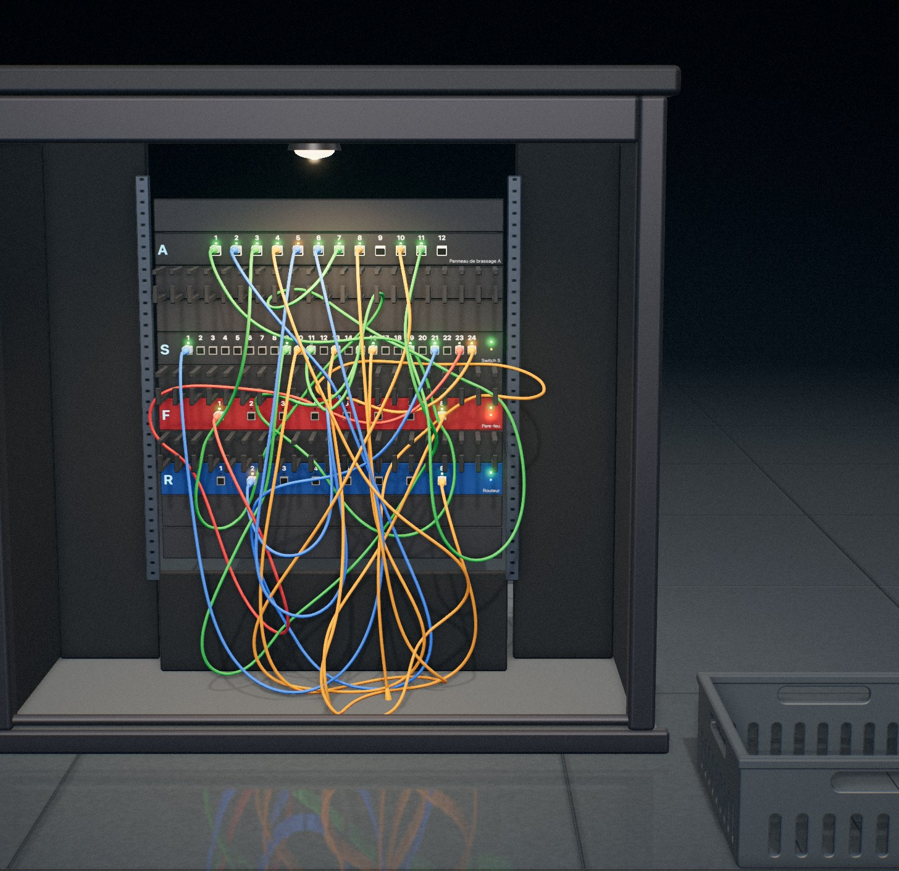

*Le niveau 4, « Étiquetage » : 13 câbles, 667 nœuds de physique. Toutes les captures du document viennent de ce niveau, rendu dans une fenêtre de 1280 × 800 pixels avec une densité de 2 pixels physiques par pixel CSS.*

## Sommaire

1. [Vue d'ensemble](#1-vue-densemble)
2. [La boucle principale](#2-la-boucle-principale)
3. [Des gestes au monde physique](#3-des-gestes-au-monde-physique)
4. [Le moteur physique](#4-le-moteur-physique)
5. [Ce que le jeu demande au moteur](#5-ce-que-le-jeu-demande-au-moteur)
6. [La physique dans un Web Worker](#6-la-physique-dans-un-web-worker)
7. [Préparer la scène pour le GPU](#7-préparer-la-scène-pour-le-gpu)
8. [Dessiner la scène](#8-dessiner-la-scène)
9. [Le post-traitement](#9-le-post-traitement)
10. [Chronologie d'une frame](#10-chronologie-dune-frame)
11. [L'écran d'accueil](#11-lécran-daccueil)
12. [Pour aller plus loin](#12-pour-aller-plus-loin)

## 1. Vue d'ensemble

### 1.1 Ce qu'est une frame

Un jeu affiche une suite d'images fixes, les *frames*. Le navigateur en demande une à chaque rafraîchissement de l'écran, souvent 60 fois par seconde : le jeu dispose alors d'environ 16,7 ms pour lire les entrées, faire avancer la simulation, préparer les données de la carte graphique (le GPU) et lancer le dessin. Si ce travail déborde, l'écran garde l'image précédente une période de plus et le mouvement saccade.

### 1.2 Trois fils d'exécution

Une frame de Brassage se partage entre trois exécutants :

- le **fil principal** de la page lit la souris, demande un pas de physique, prépare les données et lance le dessin ;
- un **Web Worker** calcule la physique des câbles, en parallèle ;
- le **GPU** exécute les passes de dessin, dans l'ordre.

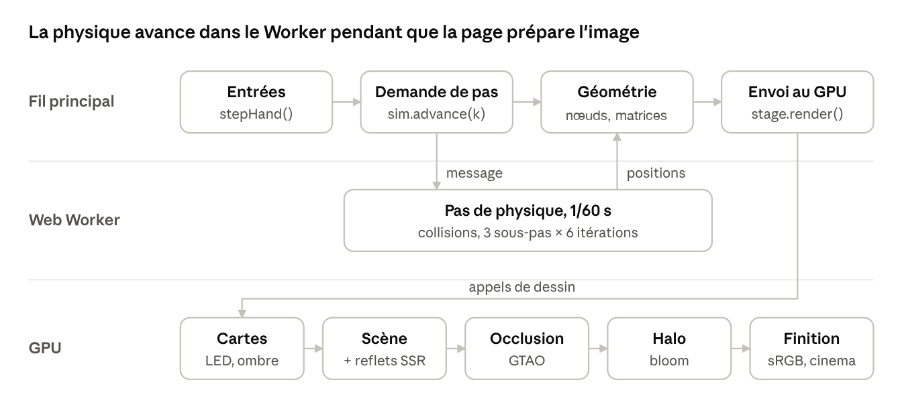

Le fil principal n'attend jamais le Worker : il dessine les dernières positions reçues.

### 1.3 Où est le code

Le moteur de câbles et le dessin des tubes sont deux paquets génériques, qui ne connaissent pas la baie. Ils vivent dans le dépôt [cable-kit](https://github.com/drschizzo/cable-kit), inclus comme sous-module dans `vendor/cable-kit`. Le jeu les mène depuis `src/`.

| Partie | Fichiers | Rôle |
| --- | --- | --- |
| Moteur physique | `vendor/cable-kit/packages/avbd-cables` (`cableSim.ts`, `threaded.ts`) | le solveur de câbles et son Worker |
| Tubes | `vendor/cable-kit/packages/three-cable-tubes` (`tube.ts`, `shared.ts`) | les câbles dessinés par le GPU à partir de leurs nœuds |
| Le jeu et ses câbles | `src/play` (`controller.ts`, `tools/`), `src/game` (`physics/rackCableSim.ts`, `routeLaying.ts`, `world.ts`) | la boucle, les gestes, ce qui mène les câbles, les règles |
| Le rendu | `src/render` (`stage.ts`, `cableView.ts`, `rackView.ts`…) | la scène three.js, ses matériaux et ses passes |

`docs/architecture.md` détaille l'organisation du code.

### 1.4 Comment lire ce document

Les parties suivent l'ordre d'exécution d'une frame et peuvent se lire séparément. Chacune se termine par une liste « À retenir ». La partie 4, sur le moteur physique, est la plus longue ; son encadré mathématique est facultatif.

## 2. La boucle principale

La boucle est une fonction que le navigateur rappelle avant chaque rafraîchissement de l'écran. Elle mesure le temps écoulé, fait avancer la physique par pas de durée fixe, puis dessine. Elle se trouve dans `src/play/controller.ts`, méthodes `frame` et `tick`.

### 2.1 requestAnimationFrame et la cadence

`requestAnimationFrame(callback)` appelle `callback` juste avant que le navigateur peigne l'image suivante, au rythme de l'écran, et suspend les appels quand l'onglet est caché. La fonction se réinscrit à chaque appel :

```ts
private frame = (): void => {
  if (this.disposed) return;
  requestAnimationFrame(this.frame);
  const now = performance.now();
  if (!this.stage.due(now)) return;
  const dt = Math.min(0.1, (now - this.last) / 1000);
  this.last = now;
  this.tick(dt);
};
```

`Stage.due` (`src/render/stage.ts`) limite le dessin à 60 images par seconde : sur un écran à 120 Hz, une image sur deux montrerait les mêmes câbles pour deux fois plus de travail du GPU. Quand la page n'a pas le focus, ou que personne n'a touché à rien depuis quelques secondes, la cadence descend à 30 images par seconde.

`dt` est le temps réel écoulé depuis la frame précédente, en secondes. Il est plafonné à 0,1 s : après une longue pause (onglet en arrière-plan, débogueur), le jeu ne tente pas de rattraper plusieurs secondes de simulation d'un coup.

### 2.2 Un pas de temps fixe pour la physique

La physique avance toujours par pas de 1/60 s (`P.dt`), quel que soit le rythme de l'affichage. Un solveur donne des résultats différents selon la taille du pas : avec un pas variable, un câble ne se poserait pas de la même façon sur deux machines.

La boucle (`stepPhysics`) accumule donc le temps réel et en retire des pas entiers :

```ts
const h = this.world.sim.P.dt;        // 1/60 s
this.physicsBacklog += dt;
let steps = 0;
while (this.physicsBacklog >= h && steps < MAX_STEPS_PER_FRAME) {   // 2
  this.hand.step();                   // la main avance vers la souris
  this.route.step(h);                 // le câble posé par l'outil Chemin avance
  this.physicsBacklog -= h;
  steps++;
}
if (this.physicsBacklog > h) { this.droppedSteps += Math.floor(this.physicsBacklog / h); this.physicsBacklog = 0; }
if (steps) this.world.sim.advance(steps);
```

En général, une frame fait un pas. Une frame en retard en fait deux. Au-delà, le temps restant est abandonné et compté dans `droppedSteps` : une machine trop lente pour la physique passe au ralenti au lieu d'accumuler un retard qui grandirait à chaque frame.

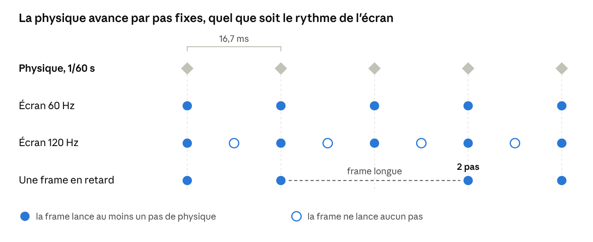

*Les losanges marquent les pas de physique, espacés de 16,7 ms. Quand une frame dure deux fois plus longtemps que prévu, la suivante lance deux pas.*

### 2.3 L'ordre des opérations dans `tick`

1. Les animations d'interface : clignotement d'un câble tracé (touche T), pulsation du repère qui montre où poser un élément. Le budget d'interruption avance aussi : chaque seconde où une liaison en production est coupée coûte le poids de son service (`World.tickDowntime`).
2. L'accumulateur et `sim.advance(steps)`, décrits plus haut. `advance` envoie la demande au Worker et rend la main aussitôt.
3. `cableView.update()` : les nœuds des câbles qui ont bougé partent vers le GPU (partie 7).
4. `rackView.syncItems(...)` : si le joueur a posé ou retiré un élément de rangement, la baie est reconstruite.
5. Toutes les 0,4 s seulement, `reevaluate()` : le score, les voyants des ports et le plan de brassage sont recalculés.
6. `tidyGlows.update()` et `holdView.update()` (`play/feedback/`) : surbrillance des câbles rangés et du câble tenu.
7. `stage.render()` : le dessin de l'image (parties 8 et 9).

Les panneaux HTML (chronomètre, plan) ne sont pas mis à jour dans cette boucle : `App` (`app/app.ts`) les actualise toutes les 250 ms par un `setInterval`.

### À retenir

- Le navigateur appelle la boucle à chaque rafraîchissement ; elle dessine au plus 60 images par seconde, 30 au repos.
- La physique avance par pas fixes de 1/60 s, au plus deux par frame.
- Ce qui n'a pas besoin d'être fait à chaque frame (score, interface HTML) est espacé.

## 3. Des gestes au monde physique

Les événements de la souris ne déplacent rien directement : ils enregistrent la position du pointeur et l'état du geste. La boucle s'en sert au moment de chaque pas de physique, si bien que la main avance au même rythme que la simulation, quelle que soit la fréquence des événements.

### 3.1 Événements et caméra

`Controller.bindInput()` installe les écouteurs sur le `<canvas>` : `pointermove`, `pointerdown`, `pointerup` (sur `window`, pour ne pas perdre un relâchement hors du canvas) et le clavier. Ils tiennent à jour la position du pointeur (`Pointer`, `play/pointer.ts`), en pixels et normalisée entre −1 et 1, le format qu'attend three.js, puis passent le geste à l'outil choisi (`play/tools/`), qui le prend ou non : sans rien sous la souris, la vue se déplace.

La caméra est pilotée par `OrbitControls`, un module de three.js : bouton droit pour tourner autour de la baie, bouton du milieu ou flèches pour déplacer la vue, molette pour zoomer. Le mouvement est amorti : la caméra glisse encore un peu après le geste.

### 3.2 Savoir quel câble est sous la souris

Dans une page web, le navigateur sait sur quel élément se trouve la souris. Dans une scène 3D dessinée sur un canvas, il faut le calculer : c'est le *picking*.

La méthode habituelle lance un rayon depuis la caméra et le teste contre les triangles. `CordPicker.pickAll()` (`play/picking.ts`) fait plus simple : il projette à l'écran les nœuds de la physique et cherche, en 2D, le segment le plus proche du pointeur.

1. Chaque nœud est converti en position à l'écran par la même transformation que celle du GPU (section 7.6), qui donne aussi sa distance à la caméra.
2. Pour chaque segment entre deux nœuds consécutifs, on mesure sa distance au pointeur. Il est retenu si elle est inférieure à l'épaisseur du câble à l'écran, plus quelques pixels.
3. Les câbles retenus sont classés du plus proche au plus lointain. Un connecteur est avantagé de quelques centimètres, pour rester attrapable au milieu d'un tas. La touche Tab passe au câble suivant de la liste.

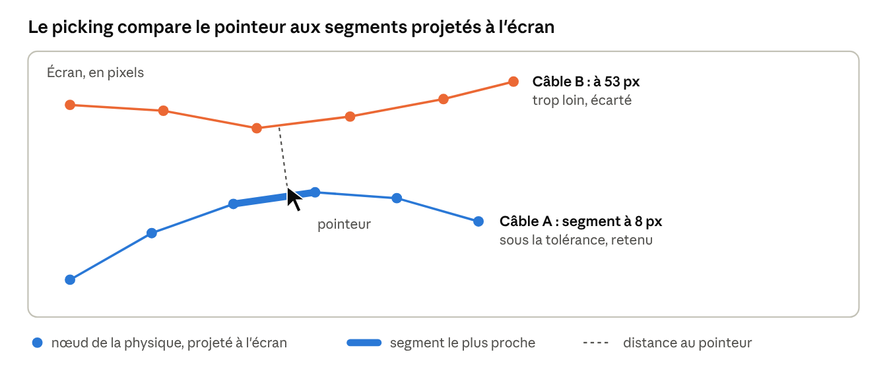

Quelques centaines de multiplications suffisent, et le résultat s'appuie sur les positions de la physique, qui sont la vérité du jeu, plutôt que sur le maillage dessiné.

### 3.3 La main

Au clic, `sim.grab(nœud)` fait du nœud saisi la « main ». Ensuite, à chaque pas, `HandTool.step()` (`play/tools/handTool.ts`) :

1. lance un rayon depuis la caméra à travers le pointeur et le coupe avec un plan vertical, à la profondeur où le câble a été saisi (avec Maj, la souris déplace la main en profondeur) ;
2. avance la main vers ce point, d'au plus 3,5 cm par pas ;
3. la garde hors des équipements, des parois et du sol ;
4. l'écrit dans `sim.grabTarget`, que le moteur lit au pas suivant ;
5. si la main tire un connecteur branché de plus de 4 cm, le débranche.

Le moteur ne téléporte pas le nœud sur la main : il le tire vers elle par un ressort en laisse (section 4.2). Un câble coincé ne s'étire donc pas comme un élastique, et ne rebondit pas quand on le lâche.

### 3.4 Les autres outils

Les autres outils agissent sur le monde physique par des appels ponctuels, appliqués dans la page puis transmis au Worker (partie 6) :

| Geste | Appel | Effet |
| --- | --- | --- |
| Brancher un connecteur | `pinEnd` | le connecteur est poussé jusqu'au port, puis épinglé (section 5.1) |
| Autre main (touche E) | `holdStill` | un nœud est tenu là où le joueur l'a laissé |
| Accrocher un connecteur en l'air, ou le sortir du tas (clic sur le plan) | `pinEnd` | le connecteur est mené là, puis épinglé jusqu'à ce qu'on le reprenne (`World.park`) |
| Pincer un coude (Espace ou clic droit maintenu) | `pinch` | la portion pincée garde sa forme (section 4.2) |
| Velcro | `addBundle` | des nœuds de plusieurs câbles sont serrés ensemble |
| Poser un élément de rangement | `setStatics` | les formes de collision de la baie changent |
| Tracer un chemin | `setGoals` | le câble est mené le long du chemin (section 5.2) |

### 3.5 Les règles du jeu

Les règles vivent dans `src/game/world.ts`, sans three.js ni DOM, et le score dans `src/game/evaluation.ts`. `evaluate()` vérifie les liaisons du plan, les portions de câble qui pendent hors d'un support, la façade dégagée et les étiquettes ; elle tourne toutes les 0,4 s. Avant chaque geste, l'outil garde une copie de l'état pour l'annulation (`UndoHistory`, Ctrl+Z, 30 états au plus).

### À retenir

- Les événements enregistrent l'état de la souris ; la boucle s'en sert à chaque pas de physique.
- Le picking projette les nœuds de la physique à l'écran et cherche le segment le plus proche du pointeur.
- La main tire le câble par un ressort en laisse ; les autres outils sont des appels ponctuels au moteur.

## 4. Le moteur physique

Le moteur, `avbd-cables`, représente chaque câble par une chaîne de points pesants. À chaque pas de 1/60 s, il cherche les positions de ces points qui respectent au mieux la gravité, la longueur des câbles, leur raideur et les contacts. Il utilise la méthode AVBD (*Augmented Vertex Block Descent*, Giles, Diaz et Yuksel, SIGGRAPH 2025).

Le solveur, `CableSim` (`vendor/cable-kit/packages/avbd-cables/src/cableSim.ts`), ne sait rien de la baie : il manipule des nœuds, des formes statiques, des cibles et des faisceaux. Ce qui mène les câbles du jeu (les mains, les ports, le chemin) vit dans une sous-classe, `RackCableSim`, décrite en partie 5.

### 4.1 Le modèle : des nœuds reliés par des segments

Un câble réel est continu. Le moteur le remplace par des **nœuds**, des masses ponctuelles espacées de 2,5 cm, reliés par des **segments** de longueur fixe. Pour les collisions, chaque segment est une gélule (un cylindre aux bouts arrondis) de 2,2 mm de rayon. Un nœud pèse 1 g ; les deux nœuds de chaque extrémité, qui portent le connecteur, pèsent 4 g. Le manchon du connecteur raidit le câble en flexion sur les quatre derniers nœuds. Ces valeurs sont celles du cordon de brassage (`CABLES.patchCord`, dans `presets.ts`).

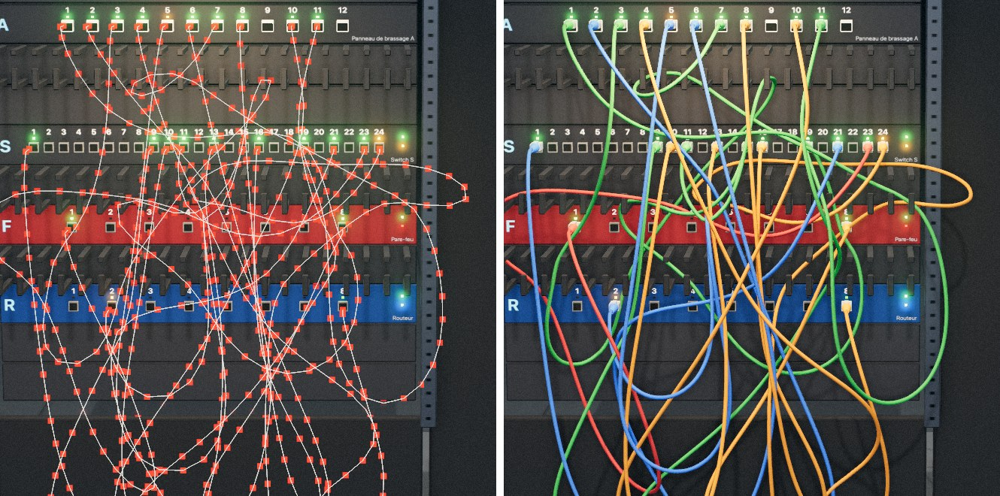

*À gauche, ce que le moteur manipule : des nœuds (en rouge) reliés par des segments (en blanc). À droite, le même instant tel que le rendu le dessine.*

Les données ne sont pas rangées dans un objet par nœud, mais dans des tableaux typés plats, un par propriété :

```ts
x    = new Float64Array(3 * N);  // positions : x0, y0, z0, x1, y1, z1, …
v    = new Float64Array(3 * N);  // vitesses
mass = new Float64Array(N);
rest = new Float64Array(N);      // longueur au repos du segment i → i+1
```

Cette organisation (*structure of arrays*) n'alloue aucun objet pendant la simulation, donc ne réveille pas le ramasse-miettes ; elle range en mémoire, côte à côte, les valeurs qu'une boucle lit à la suite ; et un tableau typé se transfère au Worker sans copie. Les contacts, la grille de collision et les listes d'adjacence suivent le même principe.

### 4.2 Ce qui agit sur un nœud

| Contribution | Nature | Effet |
| --- | --- | --- |
| Inertie et gravité | prédiction | un nœud libre continue sur sa lancée et tombe |
| Étirement | contrainte dure | chaque segment garde sa longueur au repos |
| Flexion | énergie souple | le câble résiste à la courbure, plus fort près des connecteurs |
| Contact câble–câble et câble–baie | contrainte dure, d'un seul côté | deux gélules ne s'interpénètrent pas ; un câble ne traverse pas la baie |
| Frottement | contrainte dure, bornée | un câble posé ne glisse pas tant que la force qui le pousse reste sous μ fois la force d'appui |
| Cible | ressort en laisse | un nœud est mené vers un point : la main, un port, un chemin |
| Velcro | ressort d'un seul côté | les nœuds serrés restent à moins d'un rayon du centre du faisceau |
| Coude pincé | ressort | les nœuds pincés gardent la forme qu'ils avaient ensemble |
| Épingle | nœud fixe | un connecteur branché ne bouge plus |

Une **contrainte dure** doit être respectée exactement, à la précision du calcul près. Une **énergie souple** est un ressort : elle tire sans rien imposer. Les **formes statiques** sont les boîtes et les gélules de la baie, de ses équipements et de ses éléments de rangement, décrites par `Rack.statics()` (`src/game/rack.ts`).

Trois de ces contributions méritent un mot de plus.

**La cible** (`setTarget`) est un ressort en laisse : un point, une raideur, une longueur de laisse. Le ressort ne voit jamais le point plus loin que la longueur de la laisse : un point lointain ne tire pas plus fort qu'un point au bout de la laisse. Une cible « lourde », comme la main, rend aussi son nœud lourd dans les passes de longueur (section 4.8) : le câble suit la main plutôt que l'inverse. Au début de chaque pas, `reach()` ramène chaque cible à portée du câble : un nœud ne peut pas s'éloigner d'un nœud épinglé du même câble de plus que la longueur de câble qui les sépare. Sans cela, une main tirée au-delà tendrait le câble de toute sa force contre l'épingle.

**Le coude pincé** garde la forme qu'avaient ses nœuds quand le joueur a cessé de pincer. À chaque sous-pas, le moteur cherche la rotation et le déplacement de cette forme qui vont le mieux aux nœuds (*shape matching*), et tire chaque nœud vers sa place dans la forme ainsi posée (`pinchGoals`). Le coude peut tourner et voyager avec le câble sans se déformer, et comme la forme posée est celle qui rend la traction la plus faible, le ressort n'ajoute pas d'énergie. Plus le pincement a duré, plus il est ferme.

**Le nœud fantôme** (`ghost`) traverse les autres câbles, jamais la baie. C'est le cas d'un câble posé par l'outil Chemin (section 5.2). Relâché, un nœud redevient solide dès qu'il ne chevauche plus aucun câble ; s'il en chevauche encore au bout d'un moment, il les repousse.

### 4.3 Un pas, de bout en bout

Un appel à `step()` fait avancer la simulation de 1/60 s. Il cherche les contacts une fois, puis fait 3 sous-pas de 1/180 s, chacun de 6 itérations sur les nœuds. Les niveaux de 20 câbles ou plus font 2 sous-pas de 5 itérations (`world.ts`).

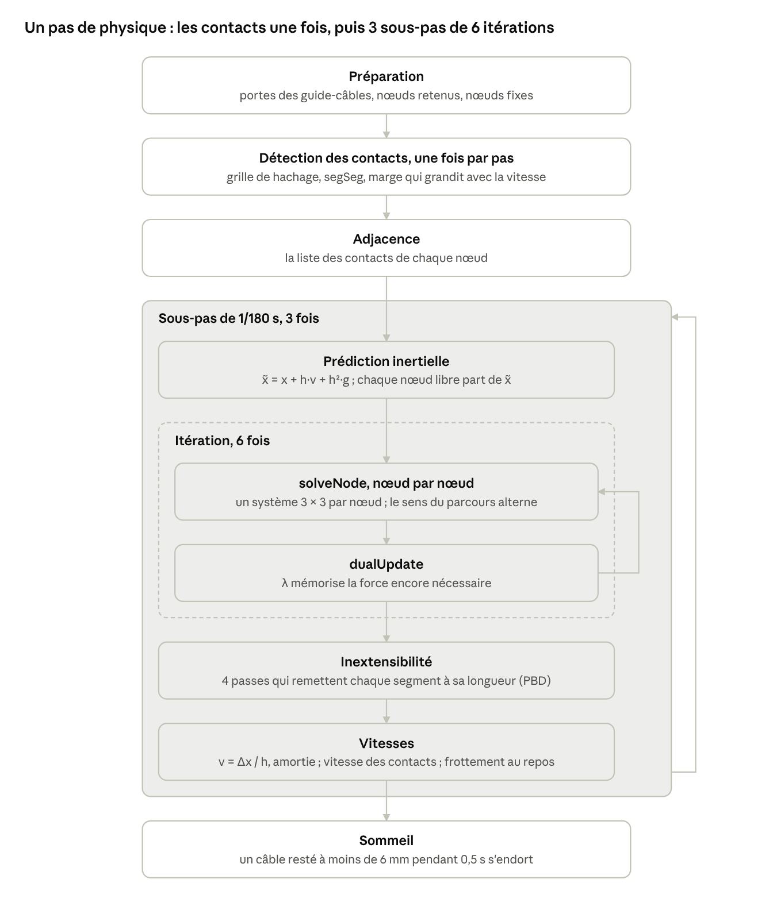

L'essentiel du calcul est dans le cadre en pointillé : les itérations sur les nœuds, répétées six fois par sous-pas. Les sections suivantes reprennent chaque bloc.

### 4.4 Le solveur : prédire, corriger, recommencer

1. **Prédire.** Chaque nœud libre avance comme s'il était seul : il garde sa vitesse et la gravité le tire vers le bas. Cette position s'appelle la *prédiction*.
2. **Corriger un nœud à la fois.** Pour chaque nœud, le moteur calcule le petit déplacement qui respecte au mieux ses contraintes (la longueur de ses deux segments, ses contacts, la raideur du câble, ses ressorts) en l'éloignant le moins possible de sa prédiction. Ses voisins sont considérés comme immobiles pendant ce calcul. Le déplacement est appliqué aussitôt : le nœud suivant voit déjà la nouvelle position.
3. **Recommencer.** Corriger un nœud dérange ses voisins : remonter un nœud raccourcit un segment et allonge l'autre. Le moteur reparcourt donc tous les nœuds six fois par sous-pas, en changeant de sens à chaque passage pour ne pas favoriser un bout du câble.

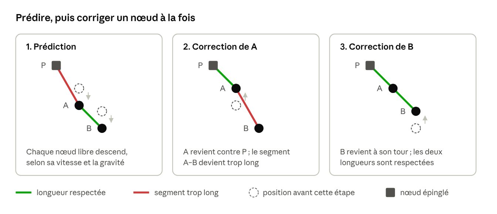

*Dans ce cas simple, un seul passage suffit. Dans un câble réel, chaque nœud a deux voisins libres et plusieurs contacts : corriger l'un déplace un peu les autres, d'où les six passages.*

**Un exemple chiffré.** Un nœud de 1 g pend sous un nœud épinglé, au repos, relié à lui par un segment de 25 mm. Un sous-pas dure h = 1/180 s.

1. *Prédiction.* La vitesse est nulle ; seule la gravité agit. En un sous-pas, elle fait descendre le nœud de g × h², soit 9,81 × (1/180)² ≈ 0,3 mm. Le segment mesurerait 25,3 mm.
2. *Correction.* La contrainte de longueur remonte le nœud de 0,3 mm.
3. *Vitesse.* À la fin du sous-pas, la vitesse est déduite du déplacement total, nul : le nœud reste immobile, comme un poids pendu à un fil.

Sans l'épingle, plus rien ne compense la gravité : les deux nœuds descendent ensemble, de plus en plus vite. C'est une chute libre.

### 4.5 Des contraintes exactes : le multiplicateur λ

Le moteur traite chaque contrainte comme un ressort très raide. Mais un ressort seul laisse toujours un petit écart : il doit être un peu étiré pour produire une force. Un câble modélisé ainsi s'allongerait sous son propre poids.

Le moteur associe donc à chaque contrainte un nombre, λ (lambda), qui mémorise la force qu'elle a fournie jusque-là. Après chaque passage sur les nœuds, `dualUpdate()` ajoute à λ la force que l'écart restant aurait demandée, et raidit le ressort là où l'écart persiste. Au bout de quelques passages, λ porte à lui seul la force réelle (la tension d'un câble tendu, le poids qu'un câble fait peser sur un autre) et l'écart devient négligeable. C'est le sens du mot *Augmented* dans le nom de la méthode.

- Pour un contact, λ ne peut que pousser : deux câbles se repoussent, ils ne s'attirent jamais.
- λ est en partie conservé d'un sous-pas à l'autre (*warm start*) : un câble tendu ou une pile au repos garde sa force au lieu de la reconstruire en s'affaissant.
- La raideur d'un contact a un plafond, exprimé en multiples de M/h² (la masse du nœud divisée par le carré du sous-pas) : 2 entre câbles au repos et contre la baie. Un câble tiré par la main a des plafonds plus hauts, 4 contre les autres câbles et 8 contre la baie, pour ne traverser ni les uns ni l'autre. Plus raides, les contacts d'une pile au repos la feraient trembler.

> **Détail mathématique (facultatif).** Prédire puis corriger revient à chercher les positions x de tous les nœuds qui rendent la quantité suivante la plus petite possible :
>
> ```math
> \frac{1}{2h^2}\,\lVert x - \tilde{x} \rVert_M^2 \;+\; E(x)
> ```
>
> Le premier terme mesure l'écart à la prédiction x̃, pondéré par les masses M ; le second, E(x), mesure à quel point les contraintes sont violées. Pour un nœud, le moteur calcule le gradient g de cette quantité et sa matrice hessienne H (3 × 3), puis résout
>
> ```math
> H\,\Delta x = -g
> ```
>
> directement (`solveSym3`, dans `geom.ts`). Traiter un nœud à la fois en réutilisant aussitôt les nouvelles positions est la méthode de Gauss-Seidel. Le déplacement est limité à 1,2 cm par résolution (`maxMove`), pour qu'un cas extrême ne projette pas un nœud au loin.

### 4.6 Les contacts

Tester chaque segment contre tous les autres coûterait, pour 667 nœuds, environ 222 000 paires par pas. La détection se fait en deux phases, une fois par pas, avant les sous-pas.

**Phase large.** L'espace est découpé en cubes un peu plus grands qu'un segment, et chaque segment est rangé dans le cube qui contient son milieu. Deux segments qui se touchent sont dans le même cube ou dans deux cubes voisins : chaque segment n'est comparé qu'à ceux de son cube et des cubes qui l'entourent. Le code ne regarde que 13 des 26 voisins, pour examiner la paire A–B une seule fois. Les cubes sont repérés par une table de hachage reconstruite à chaque pas dans des tableaux d'entiers, et un test rapide sur la distance des milieux écarte la plupart des paires restantes.

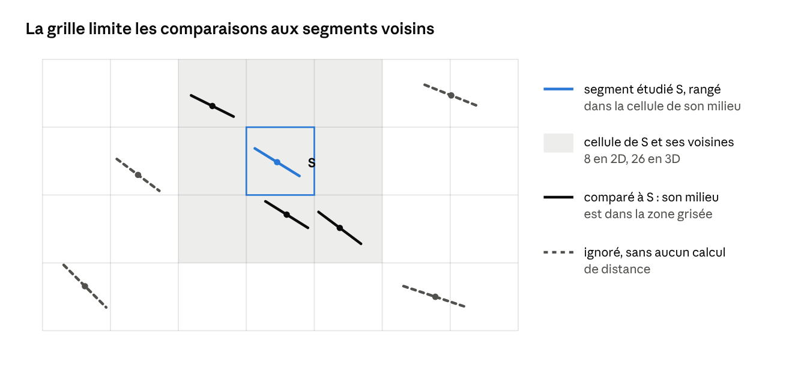

*Le schéma est en deux dimensions pour la lisibilité ; le moteur fait la même chose avec des cubes. Sur les sept autres segments, trois seulement sont comparés à S.*

**Phase fine.** Pour chaque paire restante, `segSeg()` calcule les deux points les plus proches des deux segments. S'ils sont plus proches que la somme des rayons plus une marge, un contact est créé, avec sa normale, la direction de séparation. Deux segments presque parallèles (un câble couché le long d'un autre) reçoivent deux contacts, aux deux bouts de leur recouvrement : un seul contact, au milieu, laisserait le câble basculer d'un côté puis de l'autre.

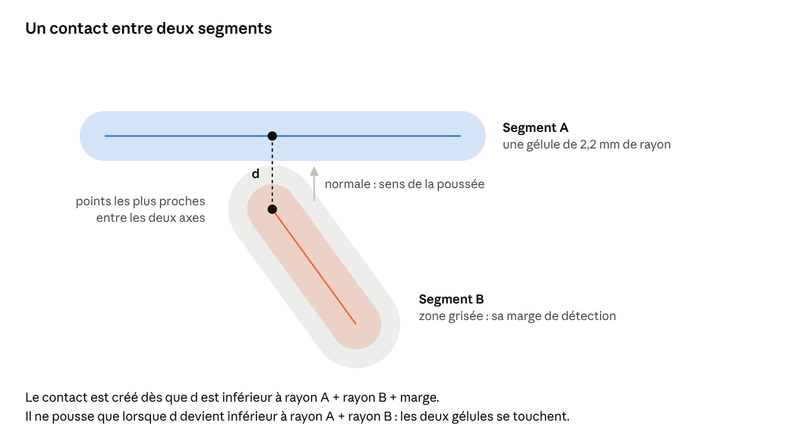

**Marge spéculative.** Les contacts étant cherchés une fois par pas, un câble rapide pourrait traverser un autre câble entre deux recherches. La marge de détection grandit donc avec la vitesse du segment, jusqu'à 8 mm entre câbles et 6 cm contre la baie. Un contact trouvé à distance ne pousse pas tant que les gélules ne se touchent pas.

**Contacts suivis.** Quand deux segments se croisent, leur point le plus proche se déplace pendant le pas. Au début de chaque sous-pas, `track()` recalcule ce point et le fait suivre les câbles ; la normale, elle, ne se retourne pas, pour qu'un câble poussé au-delà de l'axe d'un autre ressorte du côté d'où il venait. Contre une barre de la baie, seul le câble tiré par la main est suivi ainsi : c'est lui qui glisse vite.

**Contre la baie.** Les formes statiques sont rangées une fois pour toutes dans une grille de cellules de 5 cm, à chaque appel de `setStatics()`. Contre une boîte, chaque nœud reçoit son propre contact, pour qu'un câble posé à plat sur une étagère ne s'enfonce pas entre deux points d'appui. Aucune forme ne laisse passer un câble : chaque élément de rangement a une **ouverture** par où un câble peut entrer, l'avant au-dessus des doigts d'un guide-câbles, la fente de la face avant d'une goulotte, le crochet d'un anneau.

**D'un pas à l'autre.** Chaque contact porte une clé tirée des deux segments. Au pas suivant, un contact de même clé reprend la raideur, le multiplicateur λ et le point d'ancrage du frottement du précédent. Enfin, `buildAdjacency()` dresse pour chaque nœud la liste de ses contacts : `solveNode` n'a qu'à la parcourir.

### 4.7 Le frottement

Le frottement suit la loi de Coulomb : un câble posé reste immobile tant que la force qui le pousse à glisser reste inférieure à μ fois la force avec laquelle il appuie sur son support. μ vaut 0,3 entre deux câbles et 0,4 contre la baie.

Chaque contact retient l'endroit où il a commencé à coller, son *point d'ancrage*, et tire le câble vers lui. Cette force est plafonnée à μ fois la force d'appui ; au-delà, le contact glisse et l'ancrage se déplace avec lui. L'ancrage est conservé d'un pas à l'autre : c'est ce qui empêche un câble posé sur une pente de descendre lentement sans jamais s'arrêter.

### 4.8 La fin d'un sous-pas

1. **Longueurs.** Quatre passes de projection (méthode PBD) parcourent chaque câble et remettent chaque segment à sa longueur, en déplaçant ses deux nœuds selon leur poids. Elles reprennent l'étirement que les itérations laissent sous forte charge. Les épingles et les câbles endormis ne bougent pas ; le nœud de la main pèse plus que les autres.
2. **Vitesses.** La vitesse est déduite du déplacement, v = (x − x\_début) / h, puis amortie, ce qui représente la résistance de l'air.
3. **Vitesse des contacts.** Quand un contact a repoussé un nœud, ce déplacement deviendrait une petite vitesse vers l'extérieur, et une pile de câbles tremblerait sans fin : la gravité l'enfonce, le contact la soulève. Cette vitesse de séparation est retirée.
4. **Frottement au repos.** Un nœud appuyé sur un contact et presque immobile est arrêté.

### 4.9 Le sommeil

La plupart du temps, la plupart des câbles ne bougent pas. Après chaque pas, `updateSleep()` vérifie pour chaque câble si tous ses nœuds sont restés à moins de 6 mm de leur position de référence pendant 0,5 s. Si c'est le cas, le câble **s'endort** : ses nœuds deviennent fixes, les sous-pas les sautent, et il sert d'obstacle immobile aux autres. Il se réveille quand un segment en mouvement le touche ou s'enfonce en lui, quand on le saisit, ou quand la baie change.

Un câble réveillé doit reprendre exactement là où il s'était arrêté. Sinon il s'affaisse, assez vite pour réveiller ses voisins, qui s'affaissent à leur tour, et une grande baie ne se poserait jamais. Trois règles l'évitent :

- la tension d'un câble endormi (les λ de ses segments) est gardée telle quelle ;
- deux câbles endormis, ou un câble endormi et la baie, n'ont pas de contact entre eux : les contacts d'un câble qui s'endort sont mis de côté avec leur raideur, leur λ et leur ancrage, et repris à son réveil ;
- un câble touché pendant la recherche des contacts n'est réveillé qu'à la fin du pas : réveillé au milieu, il aurait manqué ses contacts avec les segments déjà examinés.

Le coût de la physique suit donc ce qui bouge. Le rendu profite aussi de cette information : un câble endormi n'est pas renvoyé au GPU (partie 7).

### 4.10 Les réglages et le nombre de sous-pas

Les réglages du moteur (`SimParams`) sont donnés pour un nombre de sous-pas de référence (`refSubsteps`). Au début de chaque pas, `convert()` les adapte au sous-pas réel pour qu'ils agissent autant par seconde : les ressorts gardent leur raideur, ce qui se fait « par sous-pas » est réparti sur des sous-pas plus courts. Plus de sous-pas rendent ainsi la simulation plus précise sans changer le comportement des câbles. Le commentaire de `SimParams`, dans `cableSim.ts`, décrit chaque réglage.

### À retenir

- Un câble est une chaîne de nœuds espacés de 2,5 cm, rangée dans des tableaux typés.
- Chaque sous-pas prédit la position des nœuds, puis les corrige un par un, six fois ; le multiplicateur λ rend les contraintes exactes.
- Les contacts sont cherchés une fois par pas, avec une grille et une marge qui grandit avec la vitesse.
- Les câbles immobiles s'endorment : le coût suit ce qui bouge.

## 5. Ce que le jeu demande au moteur

`RackCableSim` (`src/game/physics/rackCableSim.ts`) est une sous-classe de `CableSim`. Elle ajoute ce que la baie demande, sans toucher au solveur : au début de chaque pas, `prepare()` pose les cibles du jeu et les drapeaux des câbles ; pendant les itérations, `nodeTerm()` ajoute la traction du creux des guide-câbles ; autour des passes de longueur, `keepHeld()` remet les nœuds retenus à leur place.

### 5.1 Les cibles du jeu

Tout ce qui mène un câble passe par la cible du moteur (section 4.2), posée à chaque pas par `aim()` :

- **la main**, cible lourde vers `grabTarget` ;
- **l'autre main**, qui tient un nœud là où le joueur l'a laissé ;
- **le connecteur poussé dans son port** : au branchement, `pinEnd` ne téléporte pas le connecteur. Il le mène le long d'une courte course, d'abord dans l'axe du port, puis dedans, comme une main qui enfonce une fiche, et ne l'épingle qu'une fois arrivé ;
- **les buts du chemin tracé** (section 5.2).

Chaque nœud a au plus une cible. Sur un même nœud, la main l'emporte sur l'autre main, qui l'emporte sur le connecteur, qui l'emporte sur le chemin. Un câble tiré par la main ou en cours de branchement est aussi marqué *ferme* : ses contacts ont les plafonds de raideur plus hauts de la section 4.5, et il ne s'endort pas.

### 5.2 Le chemin tracé

Avec l'outil Chemin, le joueur part d'un câble et trace un trait à l'écran. Chaque guide que le trait traverse rejoint le chemin, dans l'ordre du passage ; si le trait finit sur un port libre, le bout libre du câble y sera branché. Au relâcher, `planRoute` (`src/game/routeLaying.ts`) calcule le chemin du câble :

1. il part du bout qui reste en place ;
2. il passe par les points du trait tracés hors des guides ; un cordon trop court pour tout le trait en coupe les détours, comme un câble qu'on tend ;
3. il traverse chaque guide dans un couloir libre, en y entrant par son ouverture, du côté d'où vient le trait ;
4. il finit au port d'arrivée. Un cordon trop court pour les guides est refusé, en disant combien il manque. La longueur en trop est rangée comme le ferait un technicien : en boucle dans une goulotte, sinon repliée dans un guide-câbles.

Le câble n'est pas téléporté le long de ce chemin. `RouteRun` mène chaque nœud par une cible (`setGoals`), en trois temps : sortir vers l'avant de la baie, traverser devant elle jusqu'à la forme du chemin, puis entrer par l'ouverture de chaque guide. Les contacts avec la baie restent des contraintes dures : un câble qui rencontre un élément s'y arrête. Les autres câbles, en revanche, il les traverse en fantôme (section 4.2) : mené par des ressorts plus forts que la main, il les emporterait avec lui. À la fin, le câble est relâché, et son bout libre se branche s'il est arrivé devant son port.

### 5.3 Le creux des guide-câbles

Le creux d'un guide-câbles (`keeper`) n'est pas une forme de collision mais une aide de jeu : un cordon que le joueur y a posé, à la main ou avec l'outil Chemin, y reste, libre de glisser dans sa longueur. Ses nœuds dans le creux y sont ramenés par un ressort raide pendant la résolution (`nodeTerm`), si bien que le solveur porte aussi la partie qui pend hors du guide. Le creux n'attire rien : il ne retient qu'un nœud déjà entré, le lâche quand la main le tire franchement, et lâche ceux qu'un chemin emmène ailleurs. Faire entrer un câble dans les guides est le rôle de l'outil Chemin.

### À retenir

- Le solveur est générique ; `RackCableSim` y ajoute les mains, les ports, le chemin et le creux des guides.
- Tout ce qui mène un câble est une cible en laisse ; aucun geste ne téléporte un câble.
- Un câble posé par l'outil Chemin traverse les autres câbles, jamais la baie.

## 6. La physique dans un Web Worker

JavaScript exécute le code d'une page sur un seul fil. Si la physique y prenait 10 ms, il ne resterait que 6 ms pour le reste de la frame. Un Web Worker est un second fil d'exécution, sans accès au DOM, qui communique avec la page par messages (`postMessage`).

`ThreadedSim` (`src/game/physics/threadedSim.ts`) est un `RackCableSim` passé par `threaded()` (`avbd-cables`). Il garde dans la page une copie de la simulation : la topologie et un miroir des positions. Le jeu lit `sim.x` comme si la physique tournait sur place.

- **Les modifications** (épingler, saisir, poser un velcro, changer la baie) sont appliquées à la copie locale, puis envoyées au Worker sous la forme du nom de la méthode et de ses arguments. Le Worker les rejoue dans le même ordre. Les méthodes concernées sont listées dans `mirrored`.
- **Ce qui change sans appel**, la position de la main, part avec chaque demande de pas (`stepInput`).
- **`advance(k)`** demande k pas. Une seule demande est en vol ; si le Worker prend du retard, du temps est perdu plutôt qu'accumulé.
- **La réponse** porte les positions et les câbles endormis. Le tableau de positions est *transféré* : sa mémoire change de propriétaire au lieu d'être copiée.
- **Un compteur `gen`** augmente à chaque déplacement forcé (annulation, câble reconstruit). Une réponse calculée avant porte l'ancien numéro et est ignorée.

`src/game/physics/sim.worker.ts` se borne à `hostSimWorker((p) => new RackCableSim(p))`. Le paramètre d'URL `?sync` garde la physique sur le fil principal, ce qui rend le déroulement déterministe pour les tests.

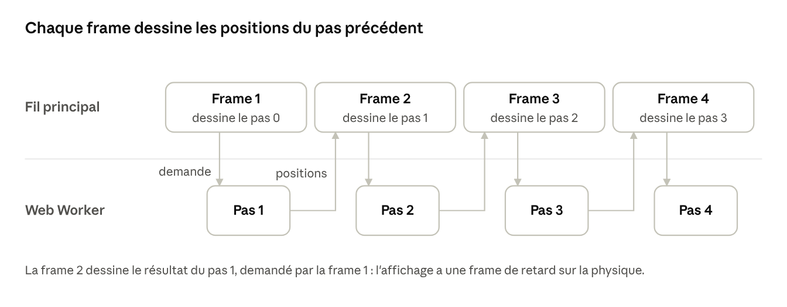

*Le pas demandé au début d'une frame se calcule pendant que la page dessine les positions du pas précédent. L'affichage a une frame de retard sur la physique, ce qui ne se voit pas à 60 images par seconde.*

### À retenir

- Le Worker calcule la physique pendant que la page dessine ; le rendu n'attend jamais.
- La page garde un miroir de la simulation et rejoue chaque modification dans le Worker, dans l'ordre.

## 7. Préparer la scène pour le GPU

Le GPU ne connaît ni les câbles ni les nœuds : il dessine des triangles à partir de tableaux de nombres rangés dans sa propre mémoire. Entre la physique et le dessin, le CPU lui envoie ce qui a changé, et rien d'autre.

### 7.1 Le graphe de scène

three.js organise ce qu'il faut dessiner en un arbre d'objets, comparable au DOM : une `Scene` contient des `Group`, qui contiennent des `Mesh`. Un `Mesh` associe une **géométrie** (des sommets et des triangles) à un **matériau** (la façon de les colorer). Chaque objet a une position, une rotation et une échelle, et hérite de celles de son parent.

Dans un niveau, la scène contient la baie (`rackView.group`), les câbles (`cableView.group`), le repère de la main, les lumières et un fond. Dans le niveau capturé, cela fait 32 meshes ordinaires et 11 meshes instanciés.

Un **appel de dessin** (*draw call*) est l'ordre que le CPU envoie au GPU pour dessiner un objet. Chaque appel a un coût fixe côté CPU et pilote, quelle que soit la taille de l'objet : mille petits objets coûtent bien plus cher qu'un gros de même nombre de triangles. Une bonne part de cette partie consiste à en faire peu.

### 7.2 Les câbles : un tube calculé par le GPU

Tous les câbles d'un niveau sont dessinés par **un seul mesh**, en *instanciation* : chaque segment de chaque câble est une instance du même bout de tube, 9 anneaux de 16 sommets. Un sommet ne porte pas sa position : il sait seulement à quel anneau du bout de tube il appartient et à quelle place autour de lui ; son instance lui dit sur quel segment de quel câble il se trouve. C'est le *vertex shader* (`three-cable-tubes/src/tube.ts`) qui calcule où se trouve chaque sommet, à partir des nœuds.

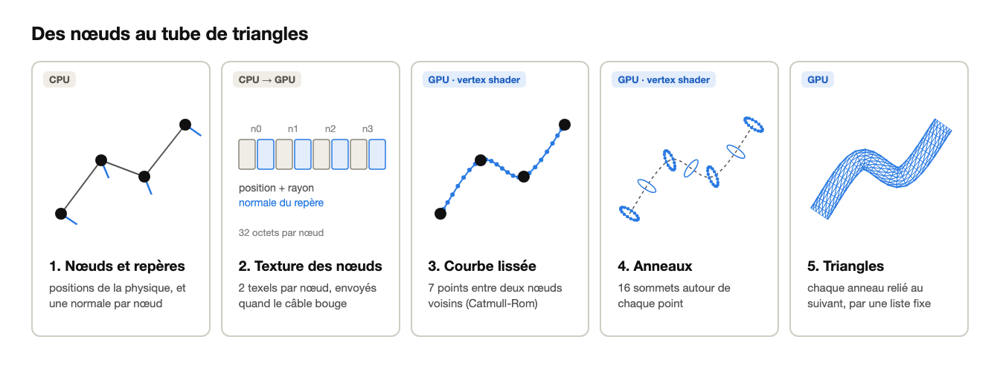

1. **Le CPU donne un repère à chaque nœud.** Pour placer un anneau autour du câble, il faut une direction perpendiculaire au câble, la *normale*. Celle d'un nœud est celle du nœud précédent, projetée sur le plan perpendiculaire à la nouvelle direction du câble (transport parallèle). Recalculée indépendamment en chaque nœud, elle ferait tourner le tube sur lui-même. Comme chaque normale dépend de la précédente, ce calcul se fait en séquence sur le CPU, en un passage par nœud.
2. **Le vertex shader lisse la chaîne de nœuds.** Entre deux nœuds, il place les anneaux sur une courbe de Catmull-Rom, qui passe par les nœuds et s'appuie sur leurs voisins pour s'incurver. La direction du câble en un point est la dérivée de la courbe ; la normale est interpolée entre celles des deux nœuds, puis redressée.
3. **Il place l'anneau** au rayon du câble, chaque sommet avec une normale tournée vers l'extérieur, qui sert à l'éclairage.
4. **Les triangles relient chaque anneau au suivant.** Leur liste est celle du bout de tube, partagée par tous les segments. Le dernier anneau d'un segment est le premier du suivant : il est dessiné deux fois, au même endroit.

Un segment ne coûte ainsi que quelques nombres : l'indice de son premier nœud, ceux des extrémités de son câble, la couleur du câble et sa position le long de lui (pour l'impression de la gaine). L'anneau et la place de chaque sommet du bout de tube sont rangés dans l'attribut `normal` de la géométrie : sans attribut de ce nom, three.js conclurait que le maillage n'a pas de normales et l'éclairerait en facettes plates.

### 7.3 Les nœuds dans une texture

Les nœuds vivent en double : une copie en JavaScript et une copie dans la mémoire du GPU, sous forme de texture (`TubeNodes`). Une texture n'est pas forcément une image : celle-ci contient des nombres. Chaque nœud y occupe trois *texels* (pixels de texture) de quatre nombres : sa position et le rayon du câble, la normale de son repère, la lueur du câble en ce nœud (surbrillance d'un câble survolé, portion tenue). Un rayon nul cache le câble.

`TubeSync` n'y écrit que les câbles qui ont bougé : un câble endormi n'est réécrit que si une signature tirée de trois de ses nœuds a changé. Modifier la copie JavaScript ne change pas la texture : il faut la marquer `needsUpdate = true`, et three.js la recopie au prochain rendu.

### 7.4 Ne dessiner que les sommets utiles

Les sommets ne coûtent presque rien au CPU, mais le GPU exécute le vertex shader pour chacun d'eux, dans chaque passe qui dessine les câbles : l'image, l'ombre, les normales des reflets et de l'occlusion ambiante, le masque des reflets. Or un câble lointain ne fait que quelques pixels de large. Trois mécanismes évitent de dépenser ce travail là où il ne se voit pas.

- **Un tube allégé hors de l'image.** Seule l'image montre le contour et l'éclairage des câbles. Les autres passes dessinent un sommet sur deux autour du câble et un anneau sur deux, par une seconde liste de triangles qui reprend les mêmes sommets. `TubeMesh` choisit la liste avant chaque dessin.
- **Un niveau de détail par tronçon.** Le vertex shader calcule le rayon du câble à l'écran, en pixels. Sous 6 pixels, un sommet sur deux se replie sur son voisin, autour du câble et le long de lui ; sous 1,5 pixel, trois sur quatre, et l'anneau restant se tourne vers la caméra, pour qu'un câble vu par la tranche ne disparaisse pas. Les triangles repliés deviennent plats et le GPU les élimine avant d'avoir un seul pixel à calculer. La liste des triangles ne change pas, donc le tube reste fermé.
- **Un niveau de détail par mesh.** Un sommet replié passe quand même par le vertex shader. Quand même le nœud le plus proche de la caméra est assez loin pour être replié, `TubeMesh` dessine directement la liste qui ne référence que les sommets qui ne se replient pas. C'est le cas de chaque baie de l'écran d'accueil. Au même seuil, `CableView` ôte la transparence des connecteurs RJ45, qui coûtait une passe de plus pour des connecteurs de deux pixels.

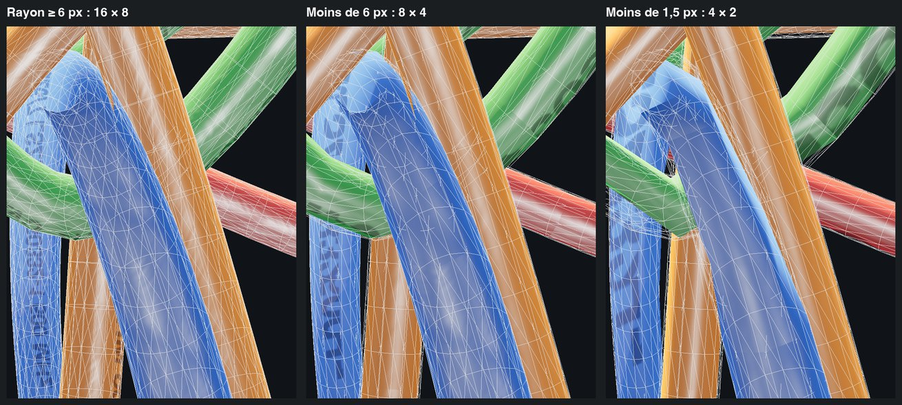

*La même vue, le niveau de détail forcé pour le rendre visible, les triangles en blanc. De gauche à droite : 16 sommets par anneau et 8 anneaux d'un nœud au suivant, puis 8 et 4, puis 4 et 2, l'anneau tourné vers la caméra. En jeu, les deux derniers ne servent qu'à des câbles de quelques pixels, où leurs facettes ne se distinguent pas.*

### 7.5 Les connecteurs, les velcros et la baie

**Les connecteurs.** Chaque câble a deux connecteurs de quatre pièces : boîtier, loquet, manchon, étiquette. Dessinées séparément, ces pièces coûteraient 8 appels de dessin par câble. Elles utilisent donc l'**instanciation** (`THREE.InstancedMesh`) : une seule géométrie de boîtier, dessinée en un appel autant de fois qu'il y a d'extrémités, chaque copie avec sa matrice et sa couleur. Il faut 8 appels pour tous les connecteurs, un par pièce et par type (fibre ou cuivre). `updateEnds()` calcule la matrice de chaque connecteur à partir des deux derniers nœuds du câble, et seules les matrices qui ont changé sont renvoyées.

**Les velcros** (`straps.ts`) sont une instance chacun d'une bande fine, ajustée en ellipse autour des câbles qu'ils serrent.

**La baie** compte des milliers de petites pièces : ports, cadres, doigts de guide-câbles, vis. Les pièces qui ne bougent jamais et partagent un matériau sont **fusionnées** en une seule géométrie (`mergeStatic`, dans `batch.ts`), dessinée en un appel ; les pièces répétées dont l'aspect change, comme les voyants, sont **instanciées**. Les pièces sont des boîtes légèrement biseautées (`bevel.ts`), d'une quarantaine de triangles : le biseau suffit à accrocher un filet de lumière sur chaque arête.

**Les voyants clignotent sans le CPU.** Chaque instance de voyant porte la façon dont il clignote (fréquence, part du temps allumé, décalage), et un seul nombre partagé avance à chaque frame, l'horloge `ledClock`. Le shader en déduit si le voyant est allumé : un nombre envoyé au lieu de centaines de couleurs.

### 7.6 La caméra et les matrices

Pour savoir où un point 3D apparaît à l'écran, le GPU lui applique trois transformations successives. Chacune est une *matrice* 4 × 4, un tableau de 16 nombres qui représente un déplacement, une rotation, un changement d'échelle ou une perspective :

```math
p_{\text{écran}} = P \cdot V \cdot M \cdot p_{\text{objet}}
```

- **M** (*model*) place l'objet dans le monde.
- **V** (*view*) exprime le monde vu depuis la caméra. C'est l'inverse de la matrice qui place la caméra.
- **P** (*projection*) applique la perspective. Après elle, le GPU divise x, y et z par la quatrième coordonnée w, ce qui ramène tout ce qui est visible dans un cube de −1 à 1.

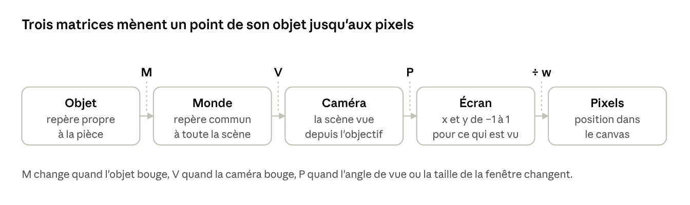

La caméra est une `PerspectiveCamera` de 32° d'angle vertical : un angle étroit réduit la déformation de perspective, comme un téléobjectif. `setViewOffset` décale l'image pour centrer la baie dans la zone que les panneaux laissent libre, sans déplacer la caméra. C'est la même matrice P · V que `CordPicker.pickAll()` utilise pour projeter les nœuds (section 3.2).

### À retenir

- Le CPU n'envoie au GPU que les nœuds des câbles qui ont bougé ; le vertex shader en tire les tubes.
- Un câble n'a que les sommets que sa taille à l'écran justifie.
- Moins d'appels de dessin, c'est moins de travail CPU : un mesh pour tous les câbles, des pièces fusionnées ou instanciées pour le reste.

## 8. Dessiner la scène

Une fois les données à jour, `stage.render()` (`src/render/stage.ts`) lance le dessin. Pour chaque objet, le GPU exécute deux petits programmes, les *shaders* : l'un place les sommets à l'écran, l'autre calcule la couleur de chaque pixel.

### 8.1 Ce que fait le GPU pour un appel de dessin

1. **Vertex shader.** Exécuté une fois par sommet, en parallèle, il calcule sa position à l'écran avec les matrices P, V et M. Pour les câbles, il calcule d'abord la position et la normale du sommet à partir des nœuds (section 7.2).
2. **Rastérisation.** Le GPU détermine quels pixels chaque triangle recouvre. Chaque pixel couvert devient un *fragment*, et les valeurs des trois sommets sont interpolées pour lui.
3. **Fragment shader.** Exécuté une fois par fragment, en parallèle, il calcule la couleur : couleur de base, lumières, ombres, reflets.
4. **Test de profondeur.** Le GPU garde pour chaque pixel la distance du fragment le plus proche déjà dessiné (le *depth buffer*) et jette les fragments plus lointains. C'est ce qui fait qu'un câble devant un port le cache, quel que soit l'ordre de dessin.

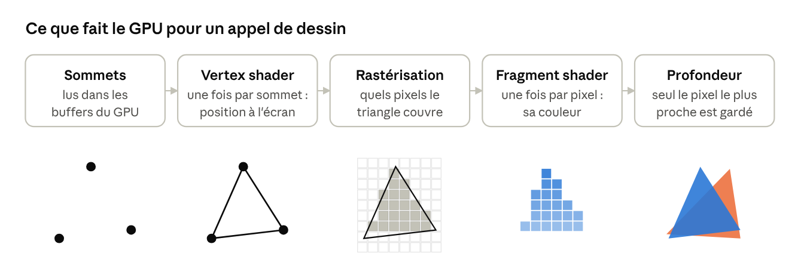

### 8.2 Les matériaux, et le code qu'on y injecte

Presque tout est dessiné avec `MeshStandardMaterial`, le matériau « physique » de three.js : une couleur, une rugosité (`roughness`, de 0 pour un miroir à 1 pour une surface mate) et un caractère métallique (`metalness`). three.js en génère les shaders, en GLSL, un langage proche du C.

Pour ajouter un comportement sans réécrire ces shaders, le projet utilise `onBeforeCompile` : juste avant la compilation, three.js passe le code source à une fonction, qui le modifie par des remplacements de texte. Le shader de three.js est découpé en blocs nommés (`#include <emissivemap_fragment>`…), qui donnent des points d'insertion stables. Voici l'essentiel de `tintable`, qui ajoute une lueur par sommet :

```ts
material.onBeforeCompile = (shader) => {
  shader.fragmentShader = shader.fragmentShader.replace(
    '#include <emissivemap_fragment>',
    '#include <emissivemap_fragment>\ntotalEmissiveRadiance += vEmissiveTint;',
  );
};
```

Mettre `vEmissiveTint` à zéro ou à une teinte vive allume ou éteint la surbrillance d'un câble, sans changer de matériau. Cinq extensions sont empilées ainsi :

| Fonction | Fichier | Code ajouté |
| --- | --- | --- |
| `tintable` | `batch.ts` | une lueur par sommet ou par instance (surbrillance d'un câble, d'un manchon) |
| `blinkable` | `leds.ts` | le clignotement des voyants ; une taille minimale de 3 pixels à l'écran |
| `jacketed` | `jacket.ts` | la gaine des câbles vue de près (section 8.3) |
| `ledLit` | `ledGlow.ts` | la lumière des voyants sur les câbles et la baie (section 8.5) |
| `swept` | `three-cable-tubes` | la position et la normale de chaque sommet des câbles, tirées de la texture des nœuds |

`swept` procède un peu autrement. Il insère son calcul au début du vertex shader, suivi de `#define position tubePos` et `#define normal tubeNormal` : tout le code qui suit, celui de three.js comme celui des autres extensions, lit la position et la normale calculées sans savoir qu'elles ne viennent pas de la géométrie. Le même ajout fonctionne donc pour n'importe quel matériau. Il laisse aussi deux valeurs aux autres extensions : `tubeCoord` (où est le sommet le long du câble et autour de lui) et `tubeTint` (la lueur du nœud le plus proche).

C'est indispensable parce que les câbles ne sont pas toujours dessinés avec leur propre matériau : l'ombre utilise un matériau de profondeur, les reflets et l'occlusion ambiante redessinent la scène avec un matériau de normales. `TubeMesh` fournit de chacun une copie passée par `swept`, créée une fois, et `customProgramCacheKey` donne à chaque variante un nom distinct pour que three.js ne réutilise pas le programme d'un matériau ordinaire.

Le jeu dessine avec `WebGLRenderer`. Le paquet des tubes a aussi une version pour `WebGPURenderer` (`three-cable-tubes/webgpu`), écrite en TSL, le langage de nœuds de three.js : le calcul est le même, donné au matériau par son `positionNode`.

### 8.3 La gaine des câbles

Un tube lisse d'une seule couleur ressemble à de la peinture. Le fragment shader de `jacket.ts` ajoute ce qu'on voit sur un vrai câble à bout de bras : le relief des paires torsadées sous la gaine d'un câble cuivre, un grain fin, un fini satiné irrégulier, et le marquage imprimé le long du câble.

Il s'appuie sur `tubeCoord` : la longueur le long du câble, mesurée au repos pour que le marquage suive le câble quand il bouge, l'angle autour du câble, et le type de câble. Le marquage est un texte dessiné une fois dans un `<canvas>` 2D, puis utilisé comme texture. Le relief ne modifie pas la géométrie : il modifie, pixel par pixel, la normale utilisée pour l'éclairage (*bump mapping*).

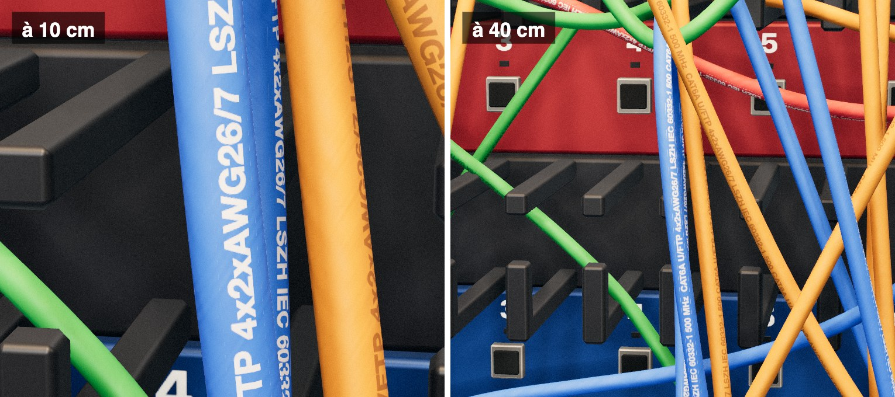

Le détail s'efface avec la distance. La fonction GLSL `fwidth` donne la variation d'une valeur d'un pixel au suivant : appliquée à la longueur le long du câble, elle dit combien de câble couvre un pixel. Quand un caractère du marquage devient plus petit qu'un pixel, le shader l'estompe. Sans cela, ces détails scintilleraient d'une frame à l'autre.

### 8.4 Les lumières et les ombres

La scène est éclairée par :

- une **lumière hémisphérique**, claire en haut et presque noire en bas, qui donne un éclairage de fond ;
- une **lumière directionnelle principale**, au-dessus et devant la baie, la seule qui projette des ombres ;
- une **lumière d'appoint** bleutée et faible, venant de la gauche ;
- une **carte d'environnement**, une petite pièce virtuelle (`RoomEnvironment`) précalculée une fois en textures floues, où les surfaces lisent leurs reflets.

Un brouillard fond le sol dans la couleur du fond, au-delà du sujet.

Le GPU ne sait pas, pour un pixel, si un objet le sépare de la lumière. La technique utilisée est la *shadow map* : avant le rendu principal, three.js dessine la scène depuis la lumière principale en ne gardant que la profondeur, dans une texture de 2048 × 2048 pixels. Pendant le rendu, chaque fragment compare sa propre distance à la lumière à celle stockée : s'il est plus loin, un objet lui cache la lumière. Plusieurs lectures autour du point adoucissent le bord de l'ombre.

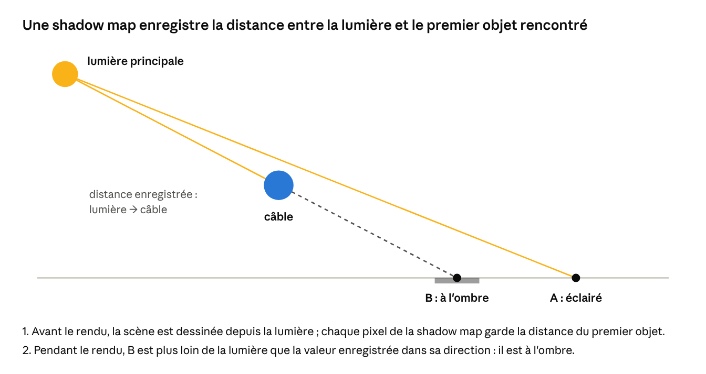

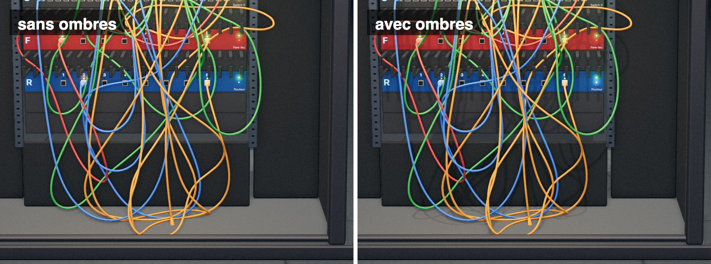

*Les ombres des câbles sur la baie donnent la profondeur : sans elles, on ne voit pas à quelle distance de la façade passe un câble.*

### 8.5 La lumière des voyants

Calculer la lumière de centaines de voyants comme de vraies sources serait trop coûteux. `ledGlow.ts` utilise un raccourci. Avant chaque frame, les voyants d'une baie sont dessinés comme des taches de couleur floues dans une petite texture de la façade vue de face, à raison d'un pixel pour 2,5 mm (240 × 320 pixels pour une baie). Cette texture est un *render target* : une image que le GPU dessine au lieu de l'écran, et qu'un autre shader peut lire ensuite.

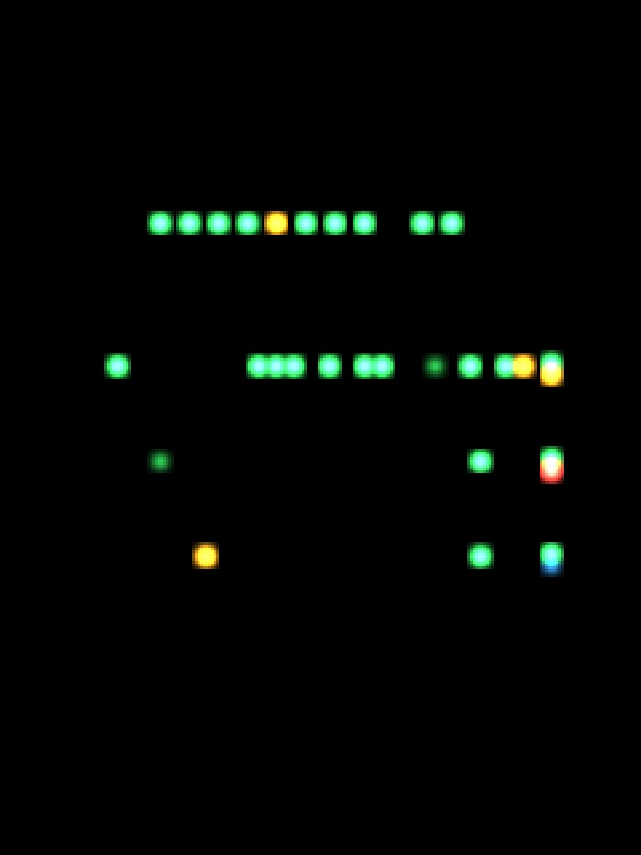

*La carte de la façade de la baie capturée, agrandie trois fois. Chaque tache est un voyant allumé.*

Après chaque dessin, le GPU calcule les *mipmaps* de la carte, des copies de plus en plus réduites où chaque pixel est la moyenne de quatre pixels du niveau précédent. Une surface lit la carte à l'endroit où elle se trouve, dans le niveau dont le flou correspond à sa distance à la façade : nette contre les voyants, de plus en plus diffuse en s'éloignant, comme la lumière d'une lampe. Quatre lectures de plus donnent la pente de la carte, donc le côté d'où vient la lumière : seule la face tournée vers le voyant est éclairée. Un câble blanc qui passe devant une rangée de voyants verts prend leur teinte et clignote avec eux. Le tout coûte un appel de dessin par baie et cinq lectures de texture par pixel éclairé.

### À retenir

- Pour chaque objet, un vertex shader place les sommets et un fragment shader colore les pixels.
- Le projet modifie les shaders de three.js par remplacement de texte (`onBeforeCompile`) plutôt que de les réécrire.
- Les ombres et la lumière des voyants sont précalculées dans des textures avant le rendu principal.

## 9. Le post-traitement

La scène n'est pas dessinée directement à l'écran. Elle est rendue dans une image intermédiaire, que cinq passes modifient tour à tour. Cette chaîne est gérée par l'`EffectComposer` de three.js, configuré dans le constructeur de `Stage`.

### 9.1 Le principe

Une passe de post-traitement lit une ou plusieurs images et en écrit une nouvelle. Le plus souvent, elle dessine un seul rectangle qui couvre l'écran, avec un fragment shader qui calcule chaque pixel à partir des pixels de l'image d'entrée : l'équivalent sur le GPU d'un filtre CSS, mais programmable et exécuté à chaque frame. La sortie d'une passe devient l'entrée de la suivante ; la dernière écrit dans le canvas.

L'image intermédiaire stocke des nombres à virgule sur 16 bits par canal (*half float*), et non des octets de 0 à 255. Une couleur peut donc dépasser 1, le blanc : les voyants brillent à 4, quand aucune surface éclairée ne dépasse 1. On parle d'image **HDR** (*high dynamic range*). Cette marge sert au halo des lumières ; la conversion finale ramène tout entre 0 et 1.

La scène est aussi multi-échantillonnée (4 échantillons par pixel, **MSAA**) : le GPU calcule la couverture de chaque triangle en 4 points par pixel, ce qui lisse les bords en escalier des câbles fins. Seule la première passe en a besoin : les suivantes ne dessinent qu'un rectangle.

### 9.2 Les passes, dans l'ordre

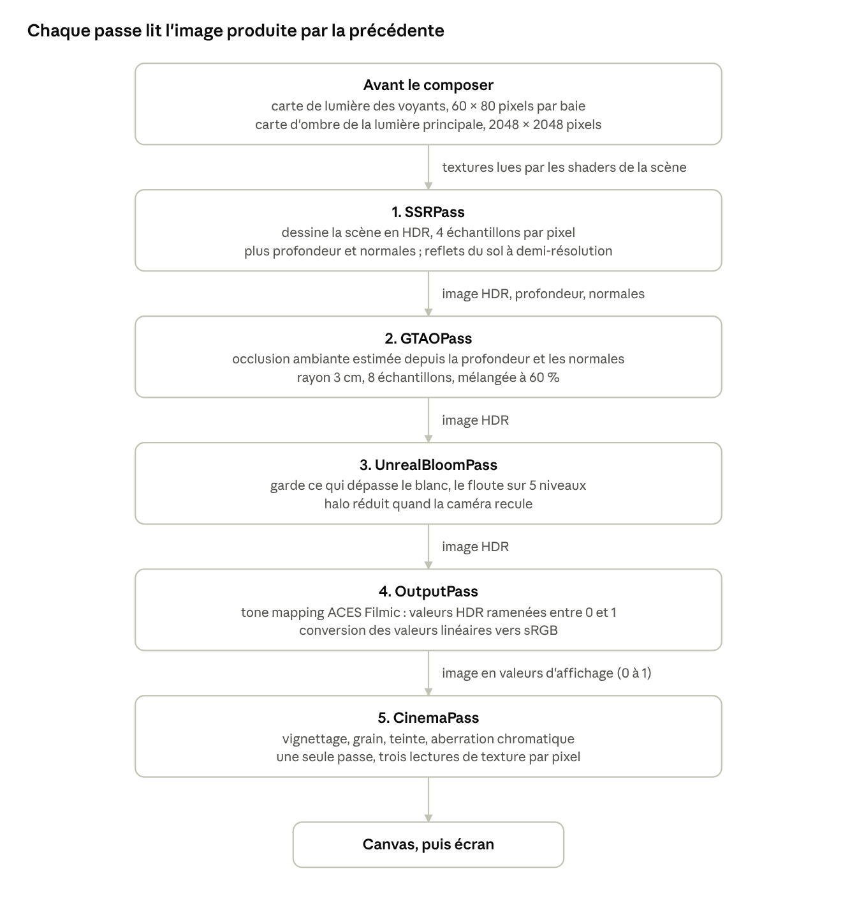

**1. SSRPass : la scène et les reflets du sol.** Cette passe dessine la scène complète dans l'image HDR, avec ses images auxiliaires : profondeur, normales et masque des surfaces réfléchissantes (seul le sol l'est). Pour chacun de ses pixels, elle suit le rayon réfléchi dans l'image de profondeur jusqu'à ce qu'il touche quelque chose : ce sont des reflets *en espace écran*, qui ne peuvent refléter que ce qui est visible. Calculés à demi-résolution, peu opaques et floutés, ils donnent l'aspect d'un vinyle ciré plutôt que d'un miroir, découpés à pleine résolution selon le masque pour ne pas déborder sur les câbles.

**2. GTAOPass : l'occlusion ambiante.** Dans un coin, sous un câble ou au fond d'un port, une partie de la lumière ambiante ne peut pas arriver, ce que les lumières de la scène ne calculent pas. Cette passe l'estime à partir de la profondeur et des normales : pour chaque pixel, elle regarde si ses voisins, dans un rayon de 3 cm, forment un creux autour de lui. Le résultat est débruité, puis mélangé à l'image à 60 %. Un rayon plus grand assombrirait tout l'enchevêtrement et lui ferait perdre ses couleurs.

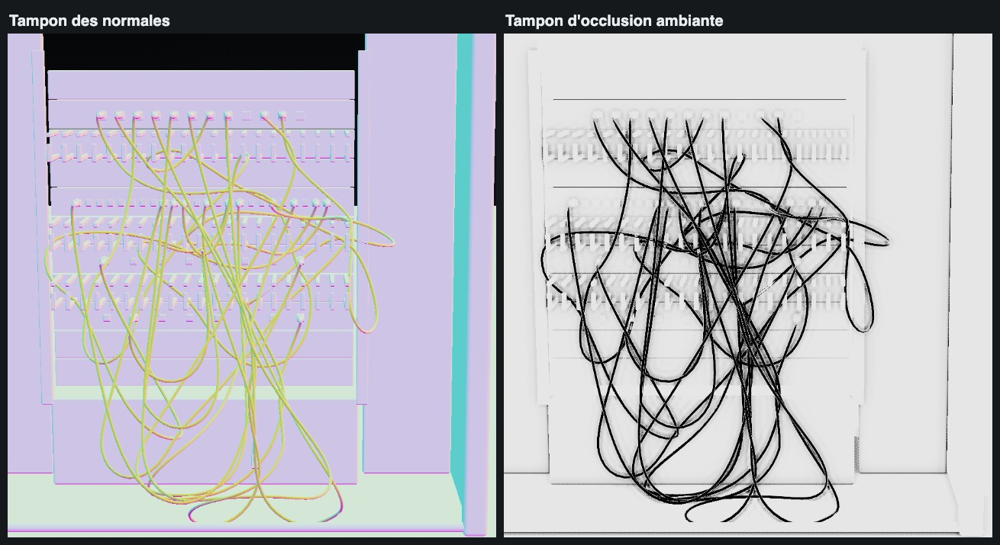

*À gauche, les normales, encodées en couleur. À droite, l'occlusion : blanc pour un pixel dégagé, sombre pour un pixel dans un creux, ici le long des câbles et entre eux.*

**3. UnrealBloomPass : le halo des lumières.** Un objet très lumineux produit un halo dans un œil ou un objectif. La passe garde les pixels au-dessus d'un seuil placé entre les surfaces éclairées (au plus 1) et les voyants (4), les floute à plusieurs échelles en réduisant l'image de moitié à chaque fois, et ajoute le résultat à l'image. Le halo se resserre quand la caméra recule : un voyant vu de loin ne fait que quelques pixels, et le même halo le noierait.

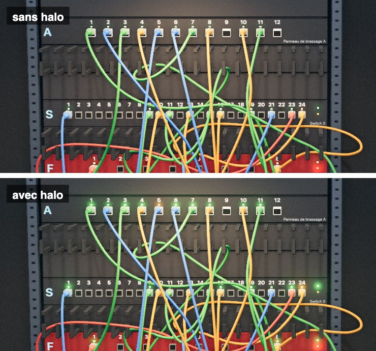

*Seuls les voyants brillent ; les façades blanches restent nettes.*

**4. OutputPass : de l'image HDR à l'écran.** Le *tone mapping* (courbe ACES Filmic) ramène les valeurs HDR entre 0 et 1 en compressant les hautes lumières au lieu de les couper. Puis la conversion vers l'espace de couleur sRGB adapte les valeurs à la façon dont un écran affiche les couleurs. Jusqu'ici, tous les calculs se faisaient en valeurs linéaires, proportionnelles à la quantité de lumière.

**5. CinemaPass : les finitions** (`cinema.ts`), sur les valeurs d'affichage, en une seule passe : un **vignettage** centré sur la zone libre entre les panneaux, un **grain** différent à chaque frame, plus fort dans les sombres, qui casse aussi les bandes des dégradés du fond, une légère **teinte** (ombres vers le bleu-vert, hautes lumières vers le chaud) et une **aberration chromatique** vers les coins.

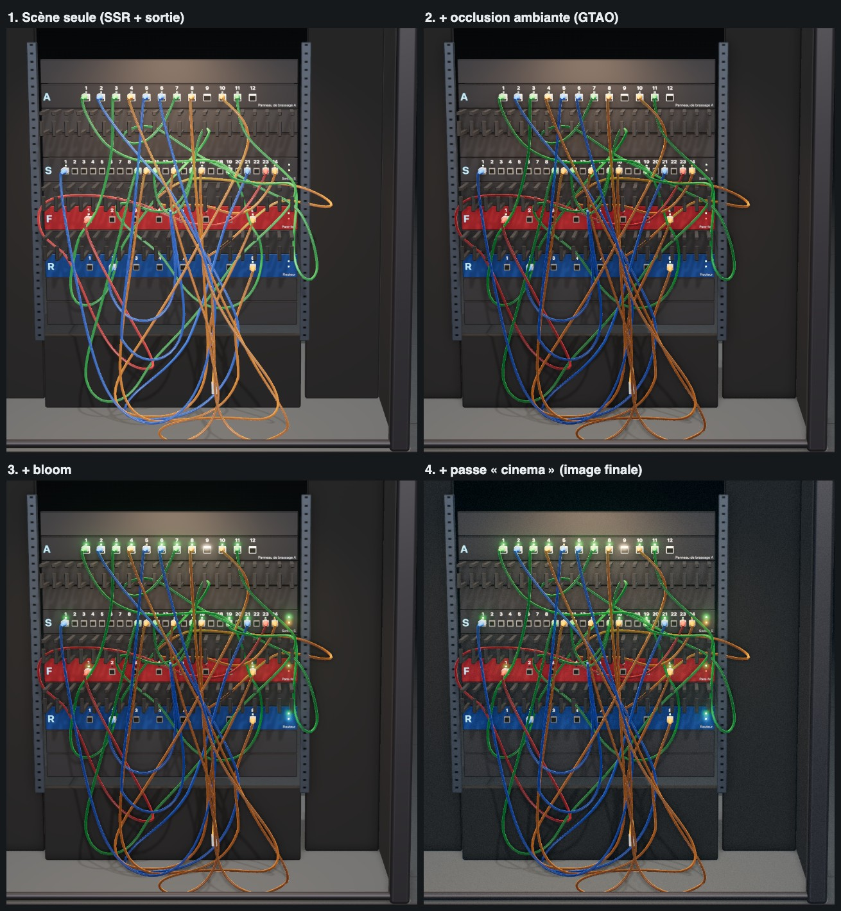

*La même image, en ajoutant les passes une à une. Les finitions donnent l'image finale, en tête du document.*

### 9.3 Une valeur invalide touche toute l'image

Les passes s'enchaînent : une valeur invalide produite au début se propage. Un triangle sans surface, par exemple, a une normale nulle ; en la normalisant, le shader d'éclairage produit une valeur NaN (*not a number*). Le flou du halo, qui mélange chaque pixel à ses voisins sur plusieurs niveaux, étendrait ce NaN à tout l'écran, qui deviendrait noir. Deux protections : les triangles sans surface sont retirés des pièces de la baie à la construction (`dropDegenerate`, dans `rackView.ts`), et le filtre d'entrée du halo lit un pixel invalide comme noir.

### À retenir

- La scène est rendue dans une image HDR, puis transformée par cinq passes successives.
- Une passe dessine un rectangle plein écran avec un shader qui lit l'image précédente.
- Le tone mapping ramène l'image HDR aux valeurs que l'écran sait afficher.

## 10. Chronologie d'une frame

Le tableau suit une frame d'un niveau, dans l'ordre d'exécution.

| # | Étape | Fil | Fichier, fonction | Fréquence |
| --- | --- | --- | --- | --- |
| 1 | Le navigateur appelle la boucle | principal | `play/controller.ts`, `frame` | chaque rafraîchissement, au plus 60 fois par seconde |
| 2 | Animations d'interface | principal | `play/controller.ts`, `tick` | chaque frame |
| 3 | La main et le chemin avancent | principal | `play/controller.ts`, `stepPhysics` (`HandTool.step`, `RouteTool.step`) | par pas de physique (0 à 2) |
| 4 | Demande de pas au Worker | principal → Worker | `threaded.ts`, `advance` | chaque frame qui a un pas |
| 5 | Cibles, contacts, 3 sous-pas × 6 itérations, sommeil | Worker | `cableSim.ts`, `step` | par pas, pendant les étapes 6 à 17 |
| 6 | Réception des positions | Worker → principal | `threaded.ts` | quand la réponse arrive |
| 7 | Repères et texture des nœuds des câbles qui ont bougé | principal | `cableView.ts`, `update` | chaque frame |
| 8 | Matrices des connecteurs, velcros | principal | `cableView.ts`, `updateEnds` | chaque frame, ce qui a changé |
| 9 | Mise à jour de la baie | principal | `rackView.ts`, `syncItems` | si un élément a changé |
| 10 | Score, voyants des ports, plan | principal | `world.ts`, `evaluate` | toutes les 0,4 s |
| 11 | Caméra, horloges des voyants et du grain | principal | `stage.ts`, `render` | chaque frame |
| 12 | Carte de lumière des voyants | GPU | `ledGlow.ts` | chaque frame, par baie |
| 13 | Carte d'ombre | GPU | three.js | chaque frame |
| 14 | Scène, images auxiliaires, reflets du sol | GPU | `SSRPass` | chaque frame |
| 15 | Occlusion ambiante | GPU | `GTAOPass` | chaque frame |
| 16 | Halo, tone mapping, finitions | GPU | `UnrealBloomPass`, `OutputPass`, `cinema.ts` | chaque frame |
| 17 | Composition avec le HTML et affichage | navigateur | — | chaque rafraîchissement |
| — | Panneaux HTML, chronomètre | principal | `app/app.ts`, `setInterval` | toutes les 250 ms |

Trois idées en ressortent.

- **La physique et le rendu se chevauchent.** Pendant que le Worker calcule le pas suivant, le fil principal prépare et lance le dessin des positions précédentes.
- **Le CPU n'envoie au GPU que ce qui change** : les nœuds des câbles éveillés, les matrices des connecteurs qui ont bougé, quelques nombres pour les horloges. Le reste de la scène reste en mémoire GPU d'une frame à l'autre.
- **Le post-traitement multiplie le travail du GPU.** Dans le niveau capturé, un rendu simple de la scène, ombre comprise, fait 86 appels de dessin ; la frame complète en fait 270, parce que les reflets et l'occlusion redessinent la scène pour leurs propres images.

## 11. L'écran d'accueil

Le jeu s'ouvre sur une allée de baies géantes en désordre, que l'interrupteur Avant / Après range sous les yeux du joueur (`src/showcase/`). Elle utilise les mêmes moteur et rendu qu'un niveau, à une autre échelle : des dizaines de milliers de nœuds, que les niveaux de détail de la section 7.4 rendent abordables.

- **Une chute précalculée.** Le désordre de la salle par défaut est tombé une fois pour toutes (`npm run bake`) et rangé dans `src/game/showcase.bin` : la position de chaque nœud, en écarts au nœud précédent au dixième de millimètre, compressés. La salle s'affiche donc sans attendre la physique. Si le code qui dispose le désordre change, l'empreinte d'une baie ne correspond plus, et cette baie retombe comme avant jusqu'au prochain précalcul.
- **La salle suivante, en fond.** Pendant qu'une salle est à l'écran, la suivante, tirée au hasard, tombe dans un Worker par baie (`game/mess/fall.worker.ts`). La page construit chaque baie par petits morceaux, une image entre deux, puis la dessine une fois hors écran pour que shaders et textures soient sur le GPU avant sa première vraie image (`Showcase.warm`). « Une autre salle » l'affiche alors aussitôt.
- **Avant / après.** Les deux états sont deux mondes qui partagent la baie et le plan de brassage : les longs cordons en désordre, et la baie rangée. Le passage de l'un à l'autre est une chorégraphie : chaque cordon est mené le long de son chemin rangé, puis échangé contre le cordon court de l'autre monde là où leurs formes coïncident.
- **La pluie de câbles** (`showcase/cableRain.ts`) est un décor, pas le moteur : chaque câble qui tombe est une petite chaîne de points (intégration de Verlet, longueurs projetées), qui se pose sur une carte de hauteur du tas puis se fige.

`?bays=N` règle le nombre de baies de l'allée, `?pairs=N` leur hauteur en paires panneau / switch, `?seed=N` tire toujours la même salle.

## 12. Pour aller plus loin

### 12.1 Observer le moteur soi-même

- `npm run dev`, puis la touche **F3** dans un niveau : nœuds, contacts, câbles éveillés, temps de physique et pas perdus.
- `?sync` dans l'URL : la physique tourne sur le fil principal, ce qui permet de la suivre au débogueur.
- La console expose `game.ctl` : `game.ctl.world.sim.x` contient les positions des nœuds, `game.ctl.stage.composer.passes` les passes, dont chacune a une propriété `enabled`. Les captures de ce document ont été faites ainsi.
- Les bancs sans navigateur : `npm run bench` pour le moteur, `npm run free` pour une partie libre de 48 câbles, `npm run route` pour l'outil Chemin ; `docs/architecture.md` les liste tous.
- [Spector.js](https://spector.babylonjs.com/), une extension de navigateur, enregistre une frame WebGL et liste chaque appel de dessin avec ses shaders et ses textures.

### 12.2 Glossaire

| Terme | Définition |
| --- | --- |
| Appel de dessin (*draw call*) | Ordre du CPU au GPU de dessiner un objet. Son coût fixe pousse à en faire peu. |
| Catmull-Rom (courbe de) | Courbe lisse qui passe par une suite de points ; elle arrondit le tube d'un câble entre deux nœuds. |
| Cible | Ressort en laisse qui mène un nœud vers un point : la main, un port, un chemin. |
| Contrainte dure | Règle que la physique respecte exactement : longueur d'un segment, non-interpénétration. |
| Fragment | Candidat pixel produit par la rastérisation d'un triangle, avant le test de profondeur. |
| Frame | Une image affichée. À 60 images par seconde, une frame dispose de 16,7 ms. |
| HDR | Image dont les valeurs peuvent dépasser le blanc (1), stockée en nombres à virgule. |
| Instanciation | Dessin d'une même géométrie plusieurs fois en un seul appel, chaque copie ayant ses propres données. |
| Matrices M, V, P | Tableaux de 4 × 4 nombres qui placent un objet dans le monde, le monde devant la caméra, puis appliquent la perspective. |
| MSAA | Couverture des triangles calculée en plusieurs points par pixel, pour lisser les bords en escalier. |
| Multiplicateur λ | Nombre associé à une contrainte, qui mémorise la force qu'elle fournit et la rend exacte. |
| Niveau de détail | Version simplifiée d'un objet, utilisée quand il est trop petit à l'écran pour que ses détails se voient. |
| Nœud | Point pesant du modèle physique. Un câble est une chaîne de nœuds espacés de 2,5 cm. |
| Pas, sous-pas | Durée simulée par un appel au solveur (1/60 s), découpée en sous-pas (1/180 s). |
| Passe | Un rendu complet dans une image (écran ou texture). Le post-traitement en enchaîne plusieurs. |
| Phase large, phase fine | Les deux étapes de la détection des collisions : trouver vite les paires proches, puis calculer le contact exact. |
| Prédiction | Position qu'aurait un nœud sans aucune contrainte, d'après sa vitesse et la gravité. |
| Rastérisation | Étape où le GPU détermine quels pixels chaque triangle recouvre. |
| Render target | Image dans laquelle le GPU dessine au lieu de l'écran, et qu'un shader peut lire ensuite. |
| Shader | Programme exécuté par le GPU : le vertex shader par sommet, le fragment shader par pixel. |
| Shadow map | Texture de profondeur vue depuis une lumière, qui dit quels pixels sont à l'ombre. |
| Sommeil | État d'un câble immobile : ses nœuds sont figés et ne sont plus calculés jusqu'à ce qu'on le touche. |
| sRGB | Espace de couleur des écrans. Les calculs se font en valeurs linéaires, converties en sRGB à la fin. |
| Texture | Tableau de valeurs dans la mémoire du GPU, qu'un shader peut lire : des couleurs, ou n'importe quels nombres. |
| Tone mapping | Conversion des valeurs HDR en valeurs affichables entre 0 et 1. |
| Web Worker | Fil d'exécution JavaScript séparé de la page, sans accès au DOM, qui communique par messages. |

### 12.3 Lectures

- `docs/architecture.md` : l'organisation du code, et où intervenir pour ajouter un niveau, un outil ou un critère de score.
- La documentation de cable-kit (`vendor/cable-kit`) : les deux paquets, leurs exemples et leurs réglages.
- La documentation de [three.js](https://threejs.org/docs/), en particulier `WebGLRenderer`, `InstancedBufferGeometry`, `InstancedMesh` et `EffectComposer`.
- L'article d'origine de la méthode : *Augmented Vertex Block Descent*, C. Giles, E. Diaz, C. Yuksel, ACM Transactions on Graphics (SIGGRAPH 2025).
